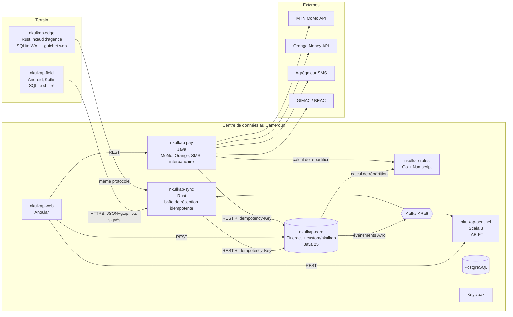
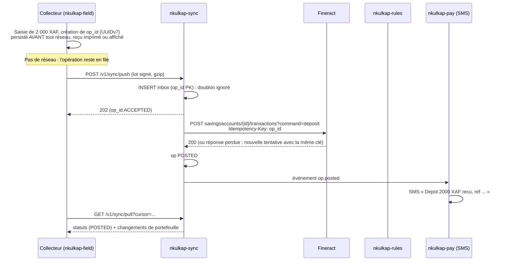
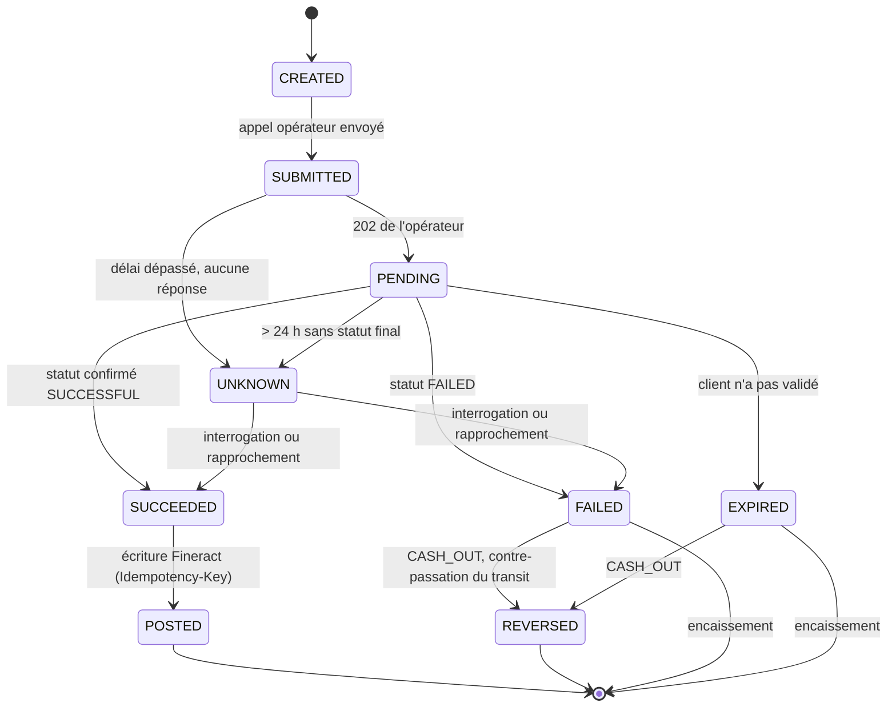
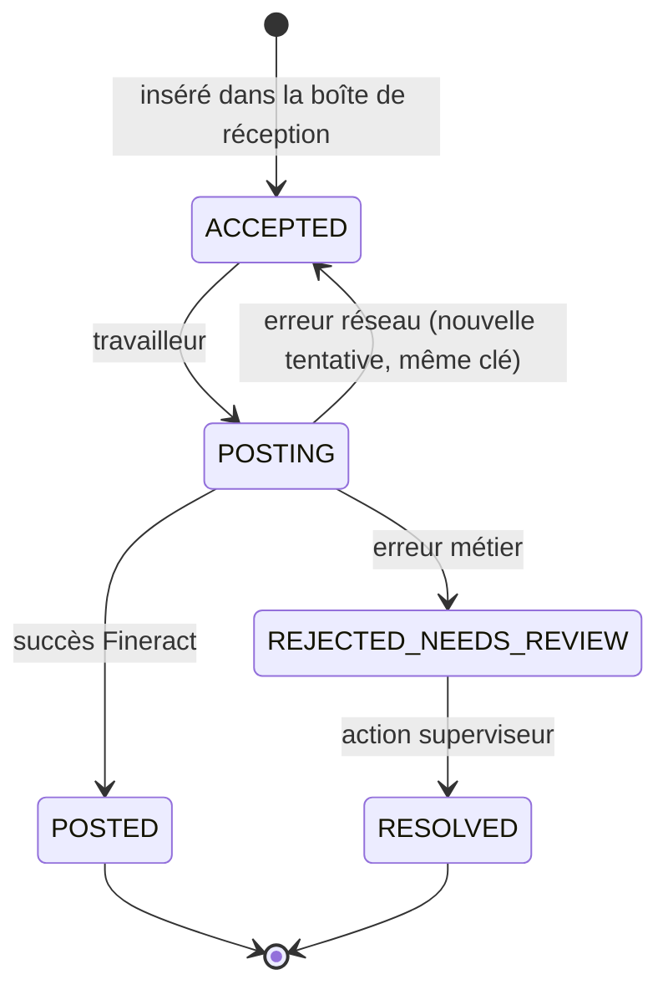
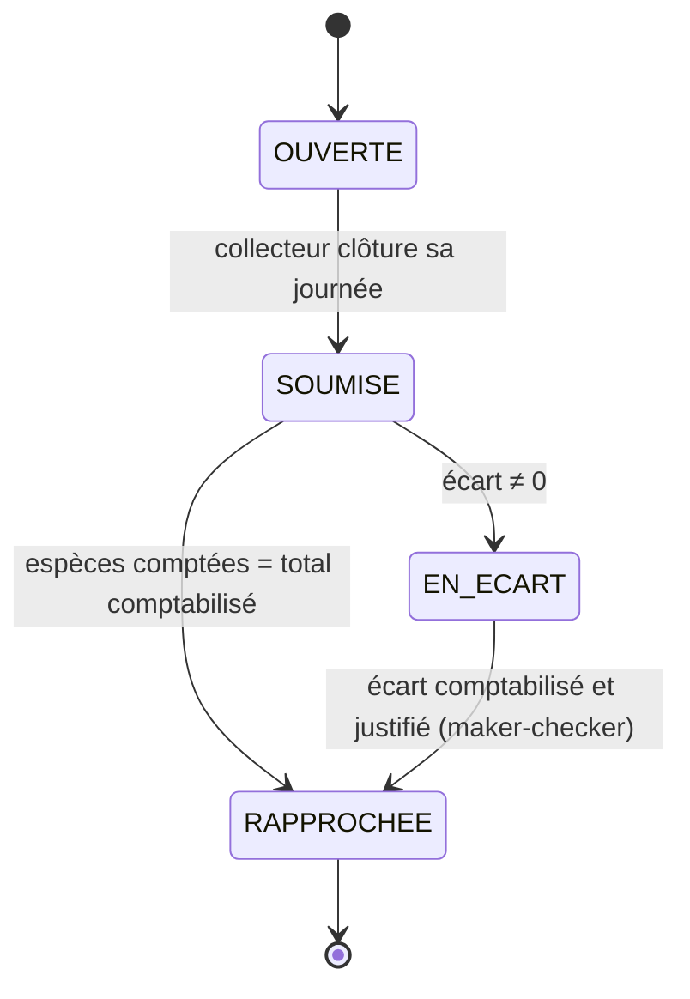

# NKULKAP — Cahier des charges et plan d'implémentation

> **NKULKAP** : un core banking pour les EMF et les banques du Cameroun. Il est construit sur Apache Fineract et conçu pour un terrain où le réseau, l'électricité et les téléphones ne sont pas fiables.
>
> **Origine du nom.** *Nkul* est le tambour d'appel des Beti, leur moyen traditionnel de télécommunication : un message passe de village en village sans aucun réseau moderne. *Nkap* désigne l'argent en camfranglais, la langue partagée par tous les Camerounais. **Nkulkap** signifie donc « le tam-tam de l'argent » : un système qui fait circuler l'argent et ses messages de façon sûre, même quand le réseau ne suit pas. C'est exactement la promesse technique du produit.

| Élément | Valeur |
|---|---|
| Version du document | 1.0 |
| Date | 21 octobre 2026 |
| Base de code de référence | Apache Fineract, branche `develop`, commit `b94b2ddf` du 20 octobre 2026 (postérieur à la 1.15.0) |
| Applications de référence | `openMF/web-app` (Angular), `openMF/android-client` (Kotlin Multiplatform), commit du 15 octobre 2026 |
| Langue du produit | Français et anglais (bilinguisme officiel du Cameroun) |
| Statut | Référence de travail. Les points marqués **[À VÉRIFIER]** reposent sur une source secondaire ou sur une hypothèse, et doivent être confirmés avant la mise en production. |

> Une recherche web du 21 octobre 2026 n'a trouvé aucun usage existant de « Nkulap », l'ancien nom du projet. **[À VÉRIFIER]** : refaire cette recherche pour « Nkulkap », puis vérifier la disponibilité officielle (marque à l'OAPI, noms de domaine) avant tout usage commercial.

---

## Table des matières

0. [Mode d'emploi pour Claude Code et les ingénieurs](#0-mode-demploi-pour-claude-code-et-les-ingénieurs)
1. [Vision et périmètre](#1-vision-et-périmètre)
2. [Contraintes du terrain camerounais](#2-contraintes-du-terrain-camerounais)
3. [Décisions d'architecture (ADR)](#3-décisions-darchitecture-adr)
4. [Architecture cible](#4-architecture-cible)
5. [Stack technologique complet](#5-stack-technologique-complet)
6. [Organisation des dépôts](#6-organisation-des-dépôts)
7. [Exigences fonctionnelles par ligne](#7-exigences-fonctionnelles-par-ligne)
8. [Exigences non fonctionnelles](#8-exigences-non-fonctionnelles)
9. [Sécurité, conformité, données personnelles et licences](#9-sécurité-conformité-données-personnelles-et-licences)
10. [Stratégie de tests](#10-stratégie-de-tests)
11. [Plan d'implémentation pas à pas](#11-plan-dimplémentation-pas-à-pas)
12. [Entrées humaines requises](#12-entrées-humaines-requises)
13. [Risques et points ouverts](#13-risques-et-points-ouverts)
14. [Annexes](#14-annexes)

---

## 0. Mode d'emploi pour Claude Code et les ingénieurs

Ce document se suit dans l'ordre. La section 11 est la feuille de route exécutable. Les sections 1 à 10 sont la référence que chaque étape cite.

### 0.1 Règles d'or (non négociables)

1. **Fineract est la seule source de vérité comptable.** Aucun autre service ne tient de solde officiel. Les services satellites postent dans Fineract par son API, avec une clé d'idempotence.
2. **Toute opération financière porte un `op_id` (UUIDv7) créé au moment de la saisie.** Il est persisté avant tout appel réseau et réutilisé à chaque nouvelle tentative. On ne génère jamais un nouvel identifiant pour retenter.
3. **Les montants XAF sont des entiers.** Le franc CFA BEAC a 0 décimale. Ne jamais utiliser `float` ni `double` pour l'argent : `long` ou `i64` pour stocker, `BigDecimal` pour calculer, avec un mode d'arrondi explicite.
4. **Ne pas modifier le cœur de Fineract.** Tout le code NKULKAP côté Fineract vit dans `custom/nkulkap/**`. Toute exception passe par un ADR approuvé et se propose en contribution amont.
5. **Chaque appel réseau a un délai d'expiration, une politique de nouvelle tentative et un comportement défini en cas d'échec.** Pas d'appel « fire and forget ».
6. **Tests d'abord pour tout calcul financier** : TEG, commissions, répartitions, intérêts, rapprochements.
7. **Aucune chaîne d'interface en dur.** Tout passe par des clés i18n, fournies en `fr` et en `en`.
8. **Les données réglementaires manquantes ne s'inventent pas.** Si une étape a besoin d'une entrée humaine (section 12), utiliser le jeu de données de remplacement marqué `FICTIF`, le signaler dans `docs/STATUS.md`, puis continuer.
9. **Fin d'étape** : tests verts, `docs/STATUS.md` mis à jour, puis commit au format Conventional Commits.

### 0.2 Comment exécuter une étape

Chaque étape de la section 11 suit le même format :

- **Faire** : ce qu'il faut construire.
- **Fichiers** : où le construire.
- **Vérifier** : les commandes à lancer.
- **Terminé quand** : les critères d'acceptation, tous obligatoires.

En début de session, Claude Code lit `CLAUDE.md` (gabarit en annexe A), `docs/STATUS.md` et l'étape en cours. Il ne relit les autres sections que lorsque l'étape les cite.

---

## 1. Vision et périmètre

### 1.1 Problème

Les EMF camerounaises travaillent avec des logiciels souvent anciens et décentralisés. Ils supportent mal la collecte de terrain, le mobile money et le reporting COBAC. Le terrain impose trois réalités : réseau intermittent, coupures d'électricité, fraude interne sur la collecte d'espèces.

### 1.2 Cibles

| Cible | Priorité | Lignes concernées |
|---|---|---|
| EMF de 1re catégorie (coopératives, mutuelles) | 1 | L1 à L8 |
| EMF de 2e catégorie (sociétés anonymes) | 1 | L1 à L8 |
| EMF de 3e catégorie | 2 | L1 à L8 |
| Banques commerciales | 3 | L1 à L9 |

### 1.3 Les neuf lignes du périmètre

Ce périmètre reprend le tableau révisé validé avec le porteur de projet. La colonne « Écart » signale ce que la vérification a changé.

| # | Besoin | Langage | Composant | Écart par rapport au tableau validé |
|---|---|---|---|---|
| L1 | Plan comptable CEMAC + hors-bilan | Java | `custom/nkulkap/coa` | Hors-bilan réalisé **sans** modifier le cœur (ADR-003) |
| L2 | TEG, plafond réglementaire (taux d'usure) | Java | `custom/nkulkap/teg` | Aucun |
| L3 | Commissions agents, partage avec opérateurs | Numscript | `nkulkap-rules` | Numscript s'exécute dans un adaptateur Go sans état (ADR-005) |
| L4 | Collecte journalière, agent collecteur, tontine | Java + Kotlin | `custom/nkulkap/collecte`, `custom/nkulkap/tontine`, `nkulkap-field` | Aucun |
| L5 | Hors-ligne | Kotlin **+ Rust** | `nkulkap-field`, `nkulkap-sync`, `nkulkap-edge` | **Rust réintroduit** : l'app Mifos n'est pas idempotente (ADR-004) |
| L6 | MTN MoMo / Orange Money | Java | `nkulkap-pay` | **Sans Payment Hub EE** (ADR-007) |
| L7 | États COBAC, centrale des risques | SQL + Java | `custom/nkulkap/reporting` | Aucun |
| L8 | LAB-FT, fraude | Scala | `nkulkap-sentinel` | Aucun |
| L9 | Interbancaire CEMAC | Java | `nkulkap-pay` (adaptateurs) | Hors Payment Hub EE, comme L6 |

### 1.4 Hors périmètre de la version 1

- Libre-service client par USSD ou application client. Prévu en v2. Seul le « USSD push » des opérateurs, utilisé dans L6, est couvert.
- Cartes bancaires et monétique.
- Crédit-bail, affacturage, finance islamique.
- Transport des opérations par SMS quand il n'y a pas de données mobiles. C'est une piste v2, voir section 13.

---

## 2. Contraintes du terrain camerounais

Chaque contrainte devient une exigence testable. C'est la raison d'être de Rust, Scala et Numscript dans ce projet.

| # | Contrainte | Conséquence concrète | Réponse NKULKAP | Composants | Exigence |
|---|---|---|---|---|---|
| C1 | Réseau 2G/3G intermittent, zones blanches rurales | Un collecteur peut passer une journée entière sans données | Fonctionnement hors-ligne d'abord : persistance locale, puis synchronisation asynchrone | `nkulkap-field`, `nkulkap-sync` | NFR-01, NFR-02 |
| C2 | Réponse perdue après enregistrement côté serveur | L'app renvoie, et le serveur comptabilise deux fois | Idempotence de bout en bout : `op_id` = en-tête `Idempotency-Key` de Fineract | `nkulkap-sync`, `nkulkap-pay` | NFR-03 |
| C3 | Données mobiles chères, débit faible | Un portefeuille complet ne peut pas se retélécharger chaque jour | Synchronisation différentielle, compression gzip, budget de données, priorité au Wi-Fi d'agence | `nkulkap-sync`, `nkulkap-field` | NFR-04 |
| C4 | Délestages électriques | Un serveur d'agence ou un téléphone peut s'éteindre en pleine écriture | Écritures durables (SQLite WAL, `fsync`), reprise automatique, onduleur | `nkulkap-edge`, `nkulkap-field` | NFR-05 |
| C5 | Horloges de téléphone fausses | La date de valeur est faussée et l'ordre des opérations est incertain | La date serveur fait foi ; horloge logique hybride (HLC) pour l'ordre ; rejet au-delà d'une dérive fixée | `nkulkap-sync` | NFR-06 |
| C6 | Agences sur liaisons lentes ou coupées (VSAT, 3G) | Le guichet s'arrête quand le lien tombe | Nœud d'agence avec mode dégradé et plafonds hors-ligne | `nkulkap-edge` | NFR-07 |
| C7 | Fraude sur la collecte d'espèces | Collecte non reversée, montants modifiés | Reçu immédiat avec code, SMS au client, GPS, rapprochement quotidien de tournée, alertes | `nkulkap-field`, `custom/nkulkap/collecte`, `nkulkap-sentinel` | FR-L4-07, FR-L8-05 |
| C8 | Mobile money : rappels perdus, statuts en attente prolongés, doublons | Argent débité chez l'opérateur mais absent du compte | Machine à états, interrogation périodique, rapprochement J+1 | `nkulkap-pay` | FR-L6-03 à 06 |
| C9 | Téléphones d'entrée de gamme | Lenteurs, plantages, mémoire saturée | Android 8 (API 26) minimum, cible 2 Go de RAM, tests sur appareil bas de gamme | `nkulkap-field` | NFR-08 |
| C10 | Bilinguisme officiel FR/EN | Clients anglophones (Nord-Ouest, Sud-Ouest) | i18n partout, y compris SMS et documents clients | Tous | NFR-09 |
| C11 | Clients sans smartphone, faible littératie numérique | Pas d'app client possible | Canaux assistés par agent, USSD push opérateur, reçus SMS en GSM-7 | `nkulkap-pay`, `nkulkap-field` | FR-L6-02 |
| C12 | Peu de personnel informatique dans les EMF | Mises à jour et sauvegardes négligées | Déploiement packagé, mises à jour signées, sauvegardes automatiques hors site, supervision par l'éditeur | Infra | NFR-10, NFR-11 |
| C13 | Réglementation COBAC, BEAC, ANIF ; loi n° 2024/017 sur les données personnelles | Sanctions, retrait d'agrément | Modules de conformité, hébergement au Cameroun par défaut, journal d'audit | L1, L2, L7, L8, infra | Section 9 |
| C14 | Budget informatique serré | Pas de grappe Kubernetes chez une petite EMF | Pile complète d'une EMF sur un seul serveur | Infra | NFR-12 |

---

## 3. Décisions d'architecture (ADR)

Chaque ADR est à recopier dans `docs/adr/NNNN-titre.md` à l'étape 0.3.

**ADR-001 — Fineract est la seule source de vérité comptable.**
Les satellites (`nkulkap-sync`, `nkulkap-pay`, `nkulkap-rules`, `nkulkap-sentinel`, `nkulkap-edge`) ne tiennent aucun solde officiel. Ils écrivent dans Fineract par son API REST, avec l'en-tête `Idempotency-Key`. Fineract le prend en charge nativement : voir `IdempotencyKeyResolver` et la propriété `fineract.idempotency-key-header-name`.

**ADR-002 — Le code NKULKAP côté Fineract vit dans `custom/nkulkap/<domaine>/<module>`.**
Fineract inclut automatiquement les modules qui suivent le motif `custom/<société>/<catégorie>/<module>` (voir `settings.gradle`). Ses migrations vont dans `db/custom-changelog`. Ses ressources REST sont des beans annotés `@Path`, enregistrés par `JerseyConfig`. Limite connue : la documentation de Fineract qualifie encore les modules personnalisés de « proof of concept ». Les modules NKULKAP ajoutent donc des fonctions nouvelles plutôt que de remplacer des services existants.

**ADR-003 — Le hors-bilan se gère par des comptes étiquetés, sans modifier `GLAccountType`.**
`GLAccountType` ne connaît que 5 types (ASSET, LIABILITY, EQUITY, INCOME, EXPENSE), dans `fineract-core`. Les comptes de classe 9 du PCEMF sont donc créés comme paires de comptes ASSET et LIABILITY qui se compensent. Ils portent l'étiquette `HORS_BILAN`, via les valeurs de code d'étiquettes de comptes de Fineract. Ils sont exclus du bilan par le moteur de reporting (L7). Un changement du cœur pourra être proposé en amont plus tard.

**ADR-004 — Rust pour `nkulkap-sync` et `nkulkap-edge`.**
Constat d'audit : l'app `openMF/android-client` envoie chaque opération hors-ligne directement à l'API Fineract, sans clé d'idempotence (0 occurrence dans le code Kotlin). En cas d'erreur, elle garde l'opération et la renvoie. Une réponse perdue après enregistrement provoque donc un doublon. Il faut une passerelle qui garantisse l'exactement-une-fois, et un nœud d'agence qui tourne des jours sur du matériel modeste sans surveillance.
Pourquoi Rust : binaire statique unique (cible `musl`, x86_64 et aarch64), empreinte mémoire faible et stable, pas de ramasse-miettes, sûreté mémoire, concurrence sûre pour des files de messages critiques.

**ADR-005 — Numscript pour les répartitions, exécuté par un adaptateur Go sans état.**
Numscript (licence MIT, `github.com/formancehq/numscript`) est une bibliothèque Go. `nkulkap-rules` est un service Go minimal, de l'ordre de 300 lignes de code applicatif, qui charge des scripts `.num`, les exécute avec la source `allowing unbounded overdraft` (calcul pur, sans solde) et renvoie des écritures. On n'utilise jamais le ledger Formance : Fineract reste la seule comptabilité (ADR-001). La logique métier vit dans les fichiers `.num`, lisibles et modifiables sans recompiler. Exemples validés en annexe B.

**ADR-006 — Scala 3 pour `nkulkap-sentinel`.**
Fineract publie ses événements métier sur Kafka au format Avro (schémas dans `fineract-avro-schemas`). Scala 3, avec Cats Effect et fs2-kafka, convient au traitement de flux à états (fenêtres glissantes, vélocité, fractionnement) et à l'expression de règles sous forme de fonctions pures testables par propriétés.

**ADR-007 — `nkulkap-pay` en Java, sans Payment Hub EE.**
Payment Hub EE épingle Zeebe 8.2.8 (`ph-ee-env-template`), une version ancienne. Depuis Camunda 8.6, l'usage en production de Camunda 8 Self-Managed, Zeebe compris, exige une licence payante. PH-EE impose en plus Kubernetes et Elasticsearch, trop lourds pour une EMF. `nkulkap-pay` est donc un service Spring Boot avec machine à états en base PostgreSQL, boîte d'envoi transactionnelle (*outbox*) et tâches planifiées. Son interface interne suit le vocabulaire de la GSMA Mobile Money API pour permettre une intégration ultérieure.

**ADR-008 — Protocole de synchronisation : JSON + gzip, versionné (v1).**
Le format reste lisible pour le débogage et gzip est natif sur Android. Si les mesures dépassent le budget de NFR-04, on passe à Protocol Buffers en v2.

**ADR-009 — PostgreSQL comme base unique, Apache Kafka en mode KRaft.**
Un seul SGBD à exploiter, supporté par Fineract. Kafka est le transport des événements externes de Fineract.

**ADR-010 — Keycloak (OIDC) pour l'identité.**
Utilisateurs du back-office, collecteurs, appareils. Fineract en mode serveur de ressources OAuth2. Double authentification pour les rôles sensibles.

**ADR-011 — Hébergement au Cameroun par défaut.**
La loi n° 2024/017, applicable depuis le 23 juin 2026, soumet le transfert de données personnelles à l'étranger à une autorisation préalable **[À VÉRIFIER : texte officiel]**. L'offre SaaS est donc hébergée dans un centre de données au Cameroun, et l'installation sur site reste possible.

**ADR-012 — Modèle de multi-location.**
Fineract est multi-locataire, avec une base par locataire. Une petite EMF partage l'instance SaaS. Une grande EMF ou une banque dispose de sa propre instance. Tous les satellites portent l'identifiant de locataire (`Fineract-Platform-TenantId`).

---

## 4. Architecture cible



Pour la lisibilité, le schéma omet deux familles de liens : tous les services centraux utilisent PostgreSQL (une base par service, plus les bases de locataires de Fineract), et toutes les authentifications passent par Keycloak.

### 4.1 Flux d'une collecte hors-ligne (cas central)



---

## 5. Stack technologique complet

Politique de versions : on épingle la version exacte dans chaque fichier de build au démarrage du projet (dernière version stable), puis on la met à jour par Renovate. Les versions ci-dessous sont celles constatées ou les minimums requis.

### 5.1 Langages et rôles

| Langage | Version | Où | Pourquoi |
|---|---|---|---|
| Java | 25 (toolchain imposée par Fineract) | `nkulkap-core` (modules custom), `nkulkap-pay` | Langue de Fineract, vivier de développeurs au Cameroun |
| Kotlin | 2.2.x (version de `android-client`) | `nkulkap-field` | Base Kotlin Multiplatform existante |
| Rust | Stable, édition 2024 | `nkulkap-sync`, `nkulkap-edge` | Fiabilité, binaire unique, faible empreinte (ADR-004) |
| Scala | Scala 3 (branche LTS) | `nkulkap-sentinel` | Traitement de flux, règles en fonctions pures (ADR-006) |
| Numscript | Bibliothèque `formancehq/numscript` (MIT) | `rules/*.num` | Répartitions lisibles (ADR-005) |
| Go | ≥ 1.24 (selon la version de Numscript épinglée) | `nkulkap-rules` (adaptateur seulement) | Imposé par la bibliothèque Numscript |
| TypeScript | Version de `openMF/web-app` | `nkulkap-web` | Base Angular existante |
| SQL | PostgreSQL | Rapports Fineract (« stretchy reports »), requêtes de reporting | Natif dans Fineract |

> Sept langages au total (Java, Kotlin, Rust, Scala, Go, Numscript, TypeScript), plus SQL. Le cœur métier reste Java et Kotlin. Rust, Scala, Go et Numscript sont confinés à des services aux frontières nettes, pour qu'un départ de développeur ne bloque qu'un composant.

### 5.2 Bibliothèques par composant

| Composant | Bibliothèques principales |
|---|---|
| `nkulkap-core` (custom Fineract) | Spring Boot (version de Fineract), Liquibase (`db/custom-changelog`), Jersey (JAX-RS), Apache POI (XLSX), Apache PDFBox (fiche TEG), JUnit 5, Cucumber (déjà inclus pour les modules custom), Mockito |
| `nkulkap-pay` | Spring Boot, Spring JDBC, Flyway, Resilience4j (délais, nouvelles tentatives, disjoncteur), ShedLock (tâches planifiées en grappe), client Fineract `fineract-client-feign`, WireMock (simulateurs), Testcontainers, jqwik |
| `nkulkap-sync` | tokio, axum, sqlx (PostgreSQL), rdkafka, serde/serde_json, async-compression (gzip), ed25519-dalek, uuid (v7), reqwest, tracing + OpenTelemetry, proptest |
| `nkulkap-edge` | tokio, axum, sqlx (SQLite, mode WAL), askama (gabarits HTML) + htmx (interface du guichet), escpos (imprimante de reçus), ed25519-dalek (vérification des mises à jour), proptest |
| `nkulkap-rules` | `github.com/formancehq/numscript`, `net/http` standard, YAML (`account_map.yaml`) |
| `nkulkap-sentinel` | Cats Effect 3, fs2-kafka + vulcan (Avro), http4s, doobie, Flyway, circe, Apache Commons Text (Jaro-Winkler), munit + munit-cats-effect, ScalaCheck, testcontainers-scala |
| `nkulkap-field` | Base `openMF/android-client` : Compose Multiplatform, Room, Ktor ; ajouts : WorkManager (synchronisation en arrière-plan), chiffrement de la base locale (ADR à rédiger à l'étape 7.6), localisation GPS |
| `nkulkap-web` | Base `openMF/web-app` : Angular, Angular Material, traductions `fr-FR` et `en-US` existantes |

### 5.3 Infrastructure et outillage

| Domaine | Choix |
|---|---|
| Base de données | PostgreSQL (version supportée par Fineract à la date du démarrage) |
| Messagerie | Apache Kafka, mode KRaft (sans ZooKeeper), un seul nœud pour une EMF seule |
| Identité | Keycloak (OIDC), double authentification pour les rôles sensibles |
| Conteneurs | Docker ; image Fineract construite avec `./gradlew :custom:docker:jibDockerBuild` |
| Déploiement mono-EMF | Docker Compose sur un serveur (NFR-12) |
| Déploiement SaaS | Kubernetes léger (k3s) + Helm |
| Nœud d'agence | Mini-PC x86_64 ou ARM64, SSD, onduleur, Linux, binaire `nkulkap-edge` géré par systemd |
| Observabilité | OpenTelemetry, Prometheus, Grafana, Loki |
| Sauvegardes | pgBackRest : sauvegarde complète quotidienne, archivage WAL continu, copie hors site au Cameroun |
| Secrets | SOPS + age dans le dépôt de configuration ; jamais de secret en clair |
| CI | GitHub Actions (ou GitLab CI), une chaîne de build par composant + E2E nocturne |
| Simulation réseau | Toxiproxy (latence, débit, coupures, réponses perdues) ; profils réseau de l'émulateur Android (`gsm`, `edge`) |
| Charge | k6 (outil interne uniquement) |
| Mises à jour de dépendances | Renovate |

---

## 6. Organisation des dépôts

Deux dépôts Git. Le premier, `nkulkap-fineract`, est un fork d'Apache Fineract qui suit une étiquette amont. Le second, `nkulkap`, est le monodépôt de tout le reste et inclut le fork comme sous-module. Les modules custom sont développés dans le monodépôt et reliés par lien symbolique dans le fork.

```text
nkulkap/                                   # monodépôt
├── CLAUDE.md                           # gabarit en annexe A
├── README.md
├── Makefile                            # bootstrap, build, test, e2e, up, down
├── docs/
│   ├── STATUS.md                       # avancement, mis à jour à chaque étape
│   ├── adr/                            # ADR-001 à ADR-0xx
│   ├── specs/                          # ce document + spécifications détaillées
│   ├── runbooks/                       # exploitation : sauvegarde, restauration, incidents
│   └── regulatory-inputs/              # textes et fichiers officiels (section 12)
├── core/
│   ├── fineract/                       # sous-module Git → nkulkap-fineract (fork)
│   └── custom-nkulkap/                    # → lien symbolique core/fineract/custom/nkulkap
│       ├── common/{core,starter}/
│       ├── coa/{core,service,starter}/         # L1
│       ├── teg/{core,service,starter}/         # L2
│       ├── collecte/{core,service,job,starter}/# L4
│       ├── tontine/{core,service,job,starter}/ # L4
│       └── reporting/{core,service,starter}/   # L7
├── services/
│   ├── nkulkap-sync/                      # Rust (Cargo workspace : api, inbox, poster, readmodel)
│   ├── nkulkap-edge/                      # Rust
│   ├── nkulkap-pay/                       # Java (Gradle multimodule : core, mtn, orange, notify, interbank, app)
│   ├── nkulkap-rules/                     # Go
│   └── nkulkap-sentinel/                  # Scala (sbt)
├── apps/
│   ├── nkulkap-field/                     # sous-module → fork de openMF/android-client (MPL-2.0)
│   └── nkulkap-web/                       # sous-module → fork de openMF/web-app (MPL-2.0)
├── rules/                              # scripts Numscript + tests
│   ├── collecte/frais_collecte.num
│   ├── momo/frais_retrait.num
│   └── account_map.yaml
├── contracts/                          # contrats partagés
│   ├── sync-v1.openapi.yaml
│   ├── pay-v1.openapi.yaml
│   ├── sentinel-v1.openapi.yaml
│   └── events/                         # schémas des événements NKULKAP
├── reports/templates/                  # gabarits d'états réglementaires (YAML)
├── simulators/
│   ├── mtn-momo/                       # WireMock + scénarios
│   └── orange-money/
├── deploy/
│   ├── compose/                        # dev, test, mono-EMF
│   ├── helm/                           # SaaS
│   └── edge/                           # image et service systemd du nœud d'agence
├── testing/
│   ├── toxiproxy/                      # profils réseau camerounais
│   ├── fixtures/                       # données FICTIVES (noms, MSISDN +237, XAF)
│   └── e2e/                            # scénarios E2E-01 à E2E-12
└── .github/workflows/
```

## 7. Exigences fonctionnelles par ligne

Conventions :
- Les tables NKULKAP dans la base Fineract sont préfixées `nkulkap_`.
- Les API NKULKAP dans Fineract sont sous `/fineract-provider/api/v1/nkulkap/...`.
- Chaque exigence porte un identifiant `FR-Lx-nn`, cité par les tests.

### L1 — Plan comptable CEMAC et hors-bilan (`custom/nkulkap/coa`)

**Ce que Fineract fournit déjà** : comptes hiérarchiques (HEADER/DETAIL), 5 types de comptes, étiquettes, règles comptables, mapping produit → comptes, écritures manuelles, clôtures, report à nouveau, provisionnement, balance.

**Exigences**

- **FR-L1-01** — Importer le plan comptable PCEMF à partir d'un fichier CSV versionné (`docs/regulatory-inputs/pcemf.csv`). Colonnes : `code`, `libelle_fr`, `libelle_en`, `classe`, `type` (ASSET, LIABILITY, EQUITY, INCOME, EXPENSE), `usage` (HEADER ou DETAIL), `code_parent`, `hors_bilan` (booléen), `saisie_manuelle` (booléen).
- **FR-L1-02** — L'import est idempotent. Le relancer ne crée aucun doublon et met à jour les libellés. Il refuse de changer le type d'un compte qui a des écritures.
- **FR-L1-03** — Les comptes de classe 9 (engagements hors-bilan) sont créés par paires qui se compensent et portent l'étiquette `HORS_BILAN` (ADR-003). Une écriture hors-bilan débite toujours un compte de la paire et crédite l'autre.
- **FR-L1-04** — Fournir des gabarits de mapping produit → comptes pour : épargne à vue, dépôt à terme, épargne programmée de collecte, crédit individuel, crédit de groupe, tontine.
- **FR-L1-05** — Configurer les « financial activity mappings » de Fineract : caisse, coffre, fonds en transit mobile money, écarts de caisse, opérations en suspens.
- **FR-L1-06** — Contrôle de cohérence : un rapport vérifie que tout compte DETAIL a un parent, que la somme des débits égale celle des crédits, et que les comptes `HORS_BILAN` sont absents du bilan.

**Données** : `nkulkap_coa_import(id, version, fichier_sha256, importe_le, importe_par, lignes_creees, lignes_maj)`.

**API** :
- `POST /nkulkap/coa/import` (multipart CSV, paramètre `dryRun=true|false`) → rapport de différences.
- `GET /nkulkap/coa/check` → rapport de cohérence.

**Acceptation** : 100 % des lignes du fichier PCEMF importées ; un second import produit 0 création ; la balance par classe est équilibrée ; le bilan exclut la classe 9.

### L2 — TEG et plafond réglementaire (`custom/nkulkap/teg`)

**Base réglementaire** : Règlement n° 04/19/CEMAC/UMAC/CM relatif au TEG, à la répression de l'usure et à la publication des conditions de banque. Les taux d'usure sont fixés par le Comité de Politique Monétaire de la BEAC, par catégorie de crédit, et révisés trimestriellement **[À VÉRIFIER : texte officiel, liste des catégories, coûts inclus dans le TEG, application aux EMF]**.

**Exigences**

- **FR-L2-01** — Calculer le TEG annuel de tout prêt par la méthode actuarielle (annexe E). Les flux comprennent : capital décaissé, intérêts, frais prélevés au décaissement, frais périodiques, assurance obligatoire, et toute charge Fineract marquée « incluse au TEG ».
- **FR-L2-02** — Chaque charge Fineract porte un attribut NKULKAP `inclus_teg` (vrai par défaut pour les frais liés à l'octroi). Il est stocké dans `nkulkap_charge_teg(charge_id, inclus_teg)`.
- **FR-L2-03** — Tenir une table des taux d'usure par catégorie et par période de validité, saisie par un administrateur avec la référence de la décision.
- **FR-L2-04** — Associer chaque produit de prêt à une catégorie réglementaire.
- **FR-L2-05** — Bloquer tout décaissement dont le TEG dépasse le taux d'usure applicable à la date d'octroi. Le blocage se fait par un écouteur sur l'événement pré-métier `LoanDisbursalBusinessEvent`, enregistré avec `addPreBusinessEventListener`. Aucune dérogation n'est possible.
- **FR-L2-06** — Simulation avant contrat : un endpoint calcule TEG et échéancier à partir des paramètres d'un produit, sans créer de prêt.
- **FR-L2-07** — Générer la fiche TEG remise au client avant signature (PDF, FR ou EN selon la langue du client) : montant, durée, taux nominal, TEG, coût total, échéancier.
- **FR-L2-08** — Rapport trimestriel des TEG moyens par catégorie, pour la déclaration au CNEF **[À VÉRIFIER : format]**.

**Données** :
- `nkulkap_usury_rate(id, categorie, taux_annuel NUMERIC(9,6), valide_du, valide_au, reference_decision, saisi_par)`
- `nkulkap_product_category(loan_product_id PK, categorie)`
- `nkulkap_loan_teg(loan_id PK, teg NUMERIC(9,6), calcule_le, taux_usure_applique, conforme BOOL)`

**API** : `GET /nkulkap/loans/{id}/teg`, `POST /nkulkap/teg/simulate`, `GET /nkulkap/loans/{id}/teg/fiche.pdf`, `CRUD /nkulkap/usury-rates`.

**Acceptation** : TEG exact au 1/10 000e de point près sur 20 cas de référence calculés à la main ou dans un tableur (fichier `testing/fixtures/teg_golden.csv`) ; décaissement bloqué au-delà de l'usure, avec message FR/EN.

### L3 — Commissions et répartitions en Numscript (`nkulkap-rules`)

**Ce que Fineract fournit déjà** : 15 déclencheurs de frais, 5 modes de calcul, taxes sur frais et sur intérêts d'épargne. NKULKAP **ne réécrit pas** ces frais.

**Ce que Numscript ajoute** : la répartition d'un montant entre plusieurs bénéficiaires (agent, collecteur, opérateur, État, EMF), avec des arrondis XAF déterministes.

**Exigences**

- **FR-L3-01** — `nkulkap-rules` expose `POST /v1/evaluate` avec `{tenant, rule_id, rule_version, variables}` et renvoie `{postings:[{source, destination, amount, asset}], rule_sha256}`.
- **FR-L3-02** — Les règles sont des fichiers `rules/<domaine>/<nom>.num`. Chacune est versionnée (version sémantique dans l'en-tête de commentaire) et accompagnée de tests.
- **FR-L3-03** — `rules/account_map.yaml` traduit chaque compte Numscript (`emf:produits:commissions_collecte`) en code GL Fineract, par locataire et éventuellement par agence.
- **FR-L3-04** — L'appelant (module Fineract ou `nkulkap-pay`) transforme les écritures en **une** écriture comptable équilibrée Fineract (`POST /journalentries`), avec `referenceNumber` = `op_id`.
- **FR-L3-05** — Les scripts sont purs : la source est toujours `allowing unbounded overdraft`, aucun solde n'est lu.
- **FR-L3-06** — Règles livrées en v1 : frais de collecte (annexe B.1), frais de retrait mobile money avec TVA et part d'agent (annexe B.2), commission de tontine.
- **FR-L3-07** — Les barèmes par tranches (grilles de frais) se calculent avant Numscript, dans l'appelant, à partir d'une table `nkulkap_fee_grid`. Numscript reçoit le montant final des frais.

**Acceptation** : chaque règle a au moins 5 cas de test, dont les cas limites (montant 0 refusé, montant 1 XAF, montants très élevés, parts à 0 % et 100 %) ; la somme des écritures est toujours égale au montant d'entrée.

### L4 — Collecte journalière, agent collecteur, tontine

#### L4a — Collecte journalière (`custom/nkulkap/collecte`)

**Ce que Fineract fournit déjà** : feuilles de collecte, guichets et caisses (Teller, Cashier), épargne programmée de fréquence journalière, épargne de groupe.

**Exigences**

- **FR-L4-01** — Rôle de collecteur : un membre du personnel Fineract lié à une agence, avec plafond d'encaisse, plafond hors-ligne par opération et par jour, et règle de commission.
- **FR-L4-02** — Carnet de collecte : lie un client à un compte d'épargne, un collecteur, une mise journalière (montant convenu), un cycle (31 jours par défaut) et une règle de frais (par défaut 1 mise par cycle **[À VÉRIFIER auprès des EMF pilotes]**).
- **FR-L4-03** — Tournée : ouverte par le collecteur en début de journée, elle regroupe toutes les collectes du jour. États : OUVERTE → SOUMISE → RAPPROCHÉE, ou EN_ÉCART.
- **FR-L4-04** — Chaque collecte est un dépôt Fineract sur le compte du carnet, réalisé par `nkulkap-sync` avec `Idempotency-Key = op_id`.
- **FR-L4-05** — Clôture de tournée : le collecteur remet les espèces au caissier, qui saisit le montant compté. L'écart est calculé contre le total des collectes comptabilisées. Un écart non nul génère une écriture sur le compte « écarts de caisse » et une alerte vers `nkulkap-sentinel`.
- **FR-L4-06** — Fin de cycle : une tâche planifiée prélève les frais de collecte et appelle `nkulkap-rules` (règle `collecte/frais_collecte`) pour répartir entre commission du collecteur et produit de l'EMF.
- **FR-L4-07** — Anti-fraude : chaque collecte affiche ou imprime un reçu avec un code court (6 caractères dérivés de `op_id`). Le client reçoit un SMS dès la comptabilisation. La position GPS est enregistrée si elle est disponible.
- **FR-L4-08** — Les rapports de collecte (par collecteur, par jour, par carnet, retards de mise) sont disponibles dans `nkulkap-web` et en rapports Fineract.

**Données** :

```sql
nkulkap_collecteur(id, staff_id UNIQUE, office_id, statut, plafond_encaisse BIGINT,
                plafond_hors_ligne_op BIGINT, plafond_hors_ligne_jour BIGINT,
                regle_commission VARCHAR, part_commission_pct NUMERIC(5,2))
nkulkap_carnet(id, client_id, savings_account_id UNIQUE, collecteur_id, mise_journaliere BIGINT,
            cycle_jours INT DEFAULT 31, regle_frais VARCHAR, debut DATE, statut)
nkulkap_tournee(id, collecteur_id, date_tournee, statut, total_comptabilise BIGINT,
             total_declare BIGINT, ecart BIGINT, rapprochee_par, rapprochee_le,
             UNIQUE(collecteur_id, date_tournee))
nkulkap_collecte_op(op_id UUID PK, carnet_id, tournee_id, montant BIGINT,
                 horodatage_appareil TIMESTAMPTZ, hlc VARCHAR, horodatage_serveur TIMESTAMPTZ,
                 savings_txn_id BIGINT, statut, lat NUMERIC(9,6), lon NUMERIC(9,6), code_recu CHAR(6))
```

**API** : `CRUD /nkulkap/collecteurs`, `CRUD /nkulkap/carnets`, `GET /nkulkap/tournees?collecteur&date`, `POST /nkulkap/tournees/{id}/soumettre`, `POST /nkulkap/tournees/{id}/rapprocher {montant_compte}`.

#### L4b — Tontine (`custom/nkulkap/tontine`)

La tontine rotative (njangi) est absente de Fineract.

> **[À VÉRIFIER]** Le cadre réglementaire applicable à une EMF qui gère des tontines pour ses clients doit être confirmé avec la COBAC ou un juriste avant la mise en production.

**Exigences**

- **FR-L4-10** — Une tontine est rattachée à un groupe Fineract. Elle définit : cotisation, fréquence (hebdomadaire, mensuelle), date de début, nombre de cycles (égal au nombre de membres), ordre de passage (FIXE ou TIRAGE en v1 ; ENCHÈRES en v2), pénalité de retard, frais de gestion de l'EMF.
- **FR-L4-11** — Chaque membre cotise depuis son compte d'épargne, en espèces par le collecteur, ou par mobile money. La cotisation crédite un compte de cagnotte (passif) de la tontine.
- **FR-L4-12** — À l'échéance d'un cycle, si la cagnotte est complète, elle est versée au bénéficiaire du cycle, moins les frais répartis par `nkulkap-rules`. Si elle est incomplète, le versement attend une validation manuelle et les retardataires sont pénalisés.
- **FR-L4-13** — Un bénéficiaire déjà servi qui cesse de cotiser est signalé en arriéré. Il est suivi comme un débiteur, avec relance par SMS.
- **FR-L4-14** — L'ordre de passage par TIRAGE est tracé : graine aléatoire enregistrée, résultat reproductible et auditable.

**Données** : `nkulkap_tontine`, `nkulkap_tontine_membre(position, a_recu)`, `nkulkap_tontine_cycle(numero, echeance, beneficiaire, statut, total_collecte)`, `nkulkap_tontine_cotisation(cycle_id, membre_id, montant, op_id, statut)`.

**Acceptation (L4)** : le scénario E2E-01 passe (300 collectes hors-ligne, 0 doublon, écart 0, commission juste) ; le scénario E2E-07 passe (tontine de 10 membres, un retard pénalisé).

### L5 — Hors-ligne (`nkulkap-field`, `nkulkap-sync`, `nkulkap-edge`)

#### L5a — `nkulkap-sync` (passerelle Rust)

- **FR-L5-01** — Enregistrement d'appareil : l'utilisateur authentifié (Keycloak) enregistre la clé publique Ed25519 générée sur l'appareil. L'appareil est lié à un utilisateur et à une agence, et révocable.
- **FR-L5-02** — Envoi (`POST /v1/sync/push`) : un lot signé contient des opérations portant `op_id`, `seq` (compteur monotone par appareil), `hlc`, `type`, `compte`, `montant`, `horodatage_appareil`, `gps` et des données propres au type. Réponse **par opération** : `ACCEPTED`, `DUPLICATE` ou `REJECTED{code}`. `ACCEPTED` signifie « stocké durablement », pas encore « comptabilisé ».
- **FR-L5-03** — Boîte de réception : `op_id` est la clé primaire. L'insertion et l'accusé de réception se font dans la même transaction. Un doublon renvoie le statut existant.
- **FR-L5-04** — Comptabilisation : un travailleur traite les opérations **dans l'ordre, par compte** (partitionnement par compte) et en parallèle entre comptes. Il appelle Fineract avec `Idempotency-Key = op_id`. Erreurs réseau : nouvelles tentatives avec attente exponentielle plafonnée et la même clé. Erreur métier (compte clôturé, solde insuffisant) : `REJECTED_NEEDS_REVIEW` et envoi dans la file du superviseur.
- **FR-L5-05** — Réception (`GET /v1/sync/pull?cursor=`) : renvoie les statuts d'opérations, les changements du portefeuille de l'utilisateur (clients, comptes, soldes, échéances dues, carnets) et la configuration (plafonds, produits, types de paiement). Pages limitées à 200 Ko compressés, avec un curseur opaque.
- **FR-L5-06** — Modèle de lecture : `nkulkap-sync` consomme les événements Kafka de Fineract pour maintenir un instantané par portefeuille, ce qui permet de calculer les différences sans solliciter Fineract. L'instantané initial se construit par l'API Fineract.
- **FR-L5-07** — Politique de conflits (table complète en annexe C.4) : un dépôt ou un remboursement est toujours tenté, car l'argent a été physiquement reçu. Un retrait hors-ligne refusé pour solde insuffisant passe en revue superviseur, qui peut l'approuver par `command=force-withdrawal` (API Fineract existante).
- **FR-L5-08** — Temps : la date de valeur est la date serveur de réception, sauf pour les opérations de la veille reçues avant l'heure limite configurée (par défaut 10 h) **[À VÉRIFIER : règle comptable de l'EMF]**. Un appareil dont l'horloge dérive de plus de 15 minutes reçoit un avertissement ; au-delà de 24 heures, ses lots sont refusés jusqu'à resynchronisation de l'horloge.
- **FR-L5-09** — Événements sortants : `op.posted` et `op.rejected` sont publiés sur Kafka. Ils déclenchent les SMS (`nkulkap-pay/notify`) et la surveillance (`nkulkap-sentinel`).

#### L5b — `nkulkap-field` (application Android)

- **FR-L5-10** — Toute opération transactionnelle (collecte, remboursement, dépôt, retrait, cotisation de tontine, création de client) passe par une **file sortante locale** (boîte d'envoi). Les appels directs à l'API Fineract pour ces opérations sont supprimés.
- **FR-L5-11** — `op_id` (UUIDv7) est créé et persisté dans la même transaction SQLite que l'opération, avant tout affichage de reçu.
- **FR-L5-12** — Synchronisation automatique en arrière-plan (WorkManager), déclenchée par le retour du réseau, avec attente exponentielle. Un bouton « Synchroniser maintenant » reste disponible.
- **FR-L5-13** — Budget de données : paramètre « Wi-Fi uniquement pour les téléchargements lourds » et compteur d'octets consommés par jour.
- **FR-L5-14** — Indicateurs visibles en permanence : nombre d'opérations en attente, âge de la plus ancienne, heure de la dernière synchronisation réussie.
- **FR-L5-15** — Contrôle des plafonds hors-ligne avant chaque opération (FR-L4-01).
- **FR-L5-16** — Sécurité locale : base chiffrée, verrouillage par code, effacement à distance à la révocation de l'appareil, déconnexion après inactivité.
- **FR-L5-17** — Reçu : écran de reçu avec code court ; impression Bluetooth ESC/POS en option.

#### L5c — `nkulkap-edge` (nœud d'agence)

- **FR-L5-20** — Le nœud d'agence est un « gros appareil » qui parle le même protocole que le téléphone (L5a), avec sa propre clé d'appareil.
- **FR-L5-21** — Il réplique le portefeuille de l'agence (clients, comptes, soldes, échéanciers) dans SQLite en mode WAL avec `synchronous=FULL`.
- **FR-L5-22** — Il sert une interface web de guichet en mode dégradé (HTML rendu côté serveur + htmx) sur le réseau local : dépôt, retrait dans la limite des plafonds, remboursement, consultation de solde (avec date de fraîcheur), impression de reçu.
- **FR-L5-23** — Quand le lien central fonctionne, le guichet normal (`nkulkap-web`) est utilisé. Le mode dégradé s'active automatiquement après 60 secondes de lien coupé, ou manuellement par le chef d'agence.
- **FR-L5-24** — Solde disponible hors-ligne = dernier solde synchronisé − retraits en attente − solde minimum. Il est plafonné par opération et par client et par jour.
- **FR-L5-25** — Autonomie : 72 heures sans lien central sans perte ni blocage.
- **FR-L5-26** — Mises à jour : téléchargées quand le lien est disponible, vérifiées par signature Ed25519, installées par remplacement atomique, avec retour arrière automatique si le contrôle de santé échoue.

**Acceptation (L5)** : scénarios E2E-01, E2E-02, E2E-03 et E2E-11.

### L6 — MTN MoMo et Orange Money (`nkulkap-pay`)

**Sources consultées** : SDK Java MoMo de MTN, guides d'intégration Orange Money Web Payment au Cameroun. Les détails d'API (en-têtes, statuts, délais) **[À VÉRIFIER]** sur la documentation officielle obtenue avec les accès marchand.

**Exigences**

- **FR-L6-01** — Opérations prises en charge :
  - `CASH_IN` : wallet → compte d'épargne ;
  - `REPAYMENT` : wallet → prêt ;
  - `TONTINE` : wallet → cotisation ;
  - `CASH_OUT` : compte d'épargne → wallet ;
  - `DISBURSEMENT` : décaissement de prêt → wallet.
- **FR-L6-02** — Encaissement par « demande de paiement » (USSD push), validée par le client sur son propre téléphone, y compris un téléphone basique. MTN : produit *Collection*, `requestToPay`. Orange : paiement marchand.
- **FR-L6-03** — Machine à états (annexe D.1) : `CREATED → SUBMITTED → PENDING → SUCCEEDED → POSTED`, avec les branches `FAILED`, `EXPIRED`, `UNKNOWN` et `REVERSED`.
- **FR-L6-04** — Idempotence : l'identifiant de l'intention de paiement (UUID) est l'identifiant de requête côté opérateur (MTN : `X-Reference-Id`) et la clé d'idempotence côté Fineract.
- **FR-L6-05** — Rappels de l'opérateur : authentifiés (secret dans l'URL et liste d'IP autorisées), dédoublonnés, et **toujours confirmés** par une requête de statut avant d'agir.
- **FR-L6-06** — Interrogation : toute intention en `PENDING` est réinterrogée selon un calendrier (1, 2, 5, 10, 30 minutes, puis toutes les heures). Après 24 heures, elle passe en `UNKNOWN` et rejoint la file de rapprochement.
- **FR-L6-07** — `CASH_OUT` et `DISBURSEMENT` : on débite d'abord Fineract vers le compte « fonds en transit mobile money », puis on appelle l'opérateur. En cas d'échec définitif, on contre-passe l'écriture.
- **FR-L6-08** — Rapprochement J+1 : import des relevés opérateur (API ou CSV), appariement par référence opérateur, puis par montant, MSISDN et date. Le rapport d'écarts est classé en 4 catégories : manquant chez nous, manquant chez l'opérateur, montant différent, en double.
- **FR-L6-09** — Numéros : normalisation au format E.164 `+2376XXXXXXXX`. La table `nkulkap_msisdn_prefix` associe chaque préfixe à un opérateur et se configure sans code.
- **FR-L6-10** — Frais : la grille `nkulkap_fee_grid` donne le montant des frais, puis la règle `momo/frais_retrait` les répartit (annexe B.2).
- **FR-L6-11** — Disjoncteur par opérateur : en cas d'indisponibilité, les nouvelles demandes sont refusées avec un message clair, et non mises en attente indéfiniment.

**Module `notify` (SMS)**
- **FR-L6-20** — Interface de fournisseur SMS indépendante de l'agrégateur ; le fournisseur se choisit par configuration.
- **FR-L6-21** — Gabarits FR et EN en GSM-7 : les accents sont translittérés pour tenir dans 160 caractères, car un seul accent fait passer le SMS en UCS-2 et sa limite tombe à 70 caractères.
- **FR-L6-22** — Déclencheurs : `op.posted` (collecte, dépôt, remboursement), résultat de paiement mobile money, rappel d'échéance la veille, arriéré de tontine.
- **FR-L6-23** — Envoi idempotent (`op_id` + gabarit), avec nouvelles tentatives et suivi des accusés de réception si l'agrégateur les fournit.

**Acceptation** : E2E-04 et E2E-05 contre les simulateurs, plus une série de tests sur l'environnement sandbox MTN (devise de test à vérifier).

### L7 — États COBAC et centrale des risques (`custom/nkulkap/reporting`)

**Contexte vérifié** : la COBAC collecte les états réglementaires des EMF par la plateforme SPECTRA, module SESAME 4.0 (télédéclaration). Le format exact des fichiers attendus n'est pas public **[À VÉRIFIER : à obtenir auprès de la COBAC ou d'une EMF agréée]**.

**Principe** : un moteur générique d'états piloté par gabarits, qui se code dès maintenant. Les gabarits officiels seront ajoutés dès que les formats seront obtenus.

**Exigences**

- **FR-L7-01** — Un gabarit d'état est un fichier YAML versionné dans `reports/templates/`. Il contient des métadonnées (code, version, périodicité, langue) et des lignes. Chaque ligne a un code, un libellé et une formule sur les soldes GL.
- **FR-L7-02** — Grammaire des formules : `SOLDE(651*)`, `DEBIT(...)`, `CREDIT(...)`, `SOLDE_DEBITEUR(...)`, `SOLDE_CREDITEUR(...)`, opérateurs `+ - * /`, références à d'autres lignes (`L12 + L13`), filtres par agence et par étiquette (`ETIQUETTE(HORS_BILAN)`).
- **FR-L7-03** — Production à une date d'arrêté, après clôture de la période. Sorties : XLSX (mise en page du gabarit), CSV, et un adaptateur `sesame` à brancher quand le format sera connu.
- **FR-L7-04** — Chaque production est figée et auditable : données sources, version du gabarit, hachage SHA-256 du fichier, auteur, date. On ne la régénère jamais en silence.
- **FR-L7-05** — Gabarits livrés en v1 : bilan, compte de résultat, balance par classe, portefeuille à risque (PAR 1, 30, 90), ancienneté des impayés, ainsi que les ratios prudentiels EMF dès que leurs définitions officielles sont obtenues.
- **FR-L7-06** — Centrale des risques : un gabarit de déclaration des encours par emprunteur au-delà d'un seuil, avec identifiants clients normalisés **[À VÉRIFIER : dispositif applicable aux EMF, format, seuil]**.
- **FR-L7-07** — Contrôles bloquants avant export : balance équilibrée, période clôturée, aucun compte DETAIL orphelin.

**Acceptation** : E2E-08 ; les états du jeu de données de démonstration se recalculent à l'identique, au franc près, sur deux exécutions.

### L8 — LAB-FT et fraude (`nkulkap-sentinel`)

**Base réglementaire** : règlement CEMAC relatif à la prévention et à la répression du blanchiment des capitaux et du financement du terrorisme ; déclarations de soupçon à l'ANIF **[À VÉRIFIER : référence du règlement en vigueur, seuils, format de la déclaration]**.

**Exigences**

- **FR-L8-01** — Entrées :
  - événements Fineract (Kafka, Avro) : clients, transactions d'épargne et de prêt ;
  - événements `nkulkap-sync` (avec GPS) ;
  - événements `nkulkap-pay`.
  Les types d'événements externes nécessaires sont activés dans Fineract (`/externalevents/configuration`).
- **FR-L8-02** — Moteur de règles : chaque règle est une fonction pure `(état, événement) → (état', alertes)`. Les seuils sont paramétrables par locataire.
- **FR-L8-03** — Règles v1 :
  1. opération en espèces ≥ seuil réglementaire ;
  2. fractionnement : plusieurs dépôts juste sous le seuil sur N jours ;
  3. vélocité anormale (nombre et montant par jour) ;
  4. entrée puis sortie rapide (> 80 % retiré sous 48 heures) ;
  5. réactivation d'un compte dormant suivie d'un gros mouvement ;
  6. nombreux déposants tiers vers un même compte ;
  7. gros dépôt sur un compte récent.
- **FR-L8-04** — Filtrage des listes de sanctions et des personnes politiquement exposées, à l'entrée en relation et à chaque mise à jour des listes. Correspondance approchée (Jaro-Winkler après normalisation des accents, de l'ordre des noms et des particules). Sources : liste consolidée du Conseil de sécurité de l'ONU (XML public), listes nationales et liste PPE interne importées.
- **FR-L8-05** — Règles propres à la collecte :
  1. collecte hors de la zone habituelle (GPS) ;
  2. lot synchronisé plus de 48 heures après la saisie ;
  3. écarts de tournée répétés ;
  4. taux d'annulation élevé ;
  5. collectes en série à des heures improbables.
- **FR-L8-06** — Dossiers : `NOUVEAU → EN_REVUE → CLASSÉ_SANS_SUITE | ESCALADÉ → DÉCLARÉ`. Tout passe par le journal d'audit, avec commentaires et pièces jointes. Le principe des quatre yeux s'applique avant une déclaration.
- **FR-L8-07** — Correspondance de sanctions confirmée : blocage des débits du compte par l'API Fineract, après validation humaine ou automatiquement selon la configuration du locataire.
- **FR-L8-08** — Export d'un brouillon de déclaration de soupçon pour l'ANIF (format à obtenir) ; en attendant, un PDF structuré.
- **FR-L8-09** — Rejouabilité : le moteur peut rejouer un historique d'événements (depuis un décalage Kafka ou une date) pour tester une nouvelle règle sans créer d'alerte réelle (mode « ombre »).

**Acceptation** : E2E-09 ; chaque règle a des tests par propriétés (ScalaCheck) ; taux de faux positifs mesuré sur le jeu de démonstration et documenté.

### L9 — Interbancaire CEMAC (`nkulkap-pay/interbank`)

Cette ligne concerne la cible banques (priorité 3). Les spécifications des systèmes ne sont pas publiques.

**Contexte** : GIMAC exploite la plateforme monétique régionale, et l'écosystème GIMACPAY relie banques, EMF et opérateurs de mobile money. Le règlement final passe par SYGMA (le RTGS de la BEAC). SYSTAC est le système de compensation **[À VÉRIFIER : modalités de connexion, normes de messages]**.

**Exigences**

- **FR-L9-01** — Interface `InterbankAdapter` dans `nkulkap-pay` : `sendCredit`, `receiveCredit`, `status`, `importStatement`, avec la même machine à états et la même idempotence que L6.
- **FR-L9-02** — Implémentation v1 par **fichiers** : export et import de virements dans un format paramétrable. ISO 20022 est l'hypothèse de travail **[À VÉRIFIER]**.
- **FR-L9-03** — Rapprochement des relevés, comme FR-L6-08.
- **FR-L9-04** — Adaptateurs temps réel GIMACPAY et SYGMA réalisés quand les spécifications et l'accès au bac à sable seront obtenus (section 12).

**Acceptation** : test de bout en bout avec un simulateur de fichiers ; le connecteur réel est hors v1 tant que les spécifications manquent.

---

## 8. Exigences non fonctionnelles

| ID | Exigence | Cible mesurable | Vérifiée par |
|---|---|---|---|
| NFR-01 | Journée de collecte hors-ligne | ≥ 300 opérations sans réseau ; aucune fonction de collecte bloquée | E2E-01 |
| NFR-02 | Aucune perte d'opération | 0 perte après arrêt forcé de l'app, redémarrage du téléphone ou batterie vide, une fois le reçu affiché | Tests d'instrumentation, E2E-01 |
| NFR-03 | Exactement une fois | 0 doublon sous toutes les pannes réseau de `testing/toxiproxy` | E2E-02, tests par propriétés |
| NFR-04 | Sobriété en données | Envoi de 300 opérations ≤ 50 Ko compressés ; synchronisation quotidienne d'un portefeuille de 500 clients ≤ 300 Ko | Mesure automatique en CI |
| NFR-05 | Durabilité sur coupure électrique | 0 perte sur `kill -9` ou coupure simulée du nœud d'agence | E2E-11 |
| NFR-06 | Ordre et temps | Ordre par compte respecté ; dérive d'horloge détectée | Tests `nkulkap-sync` |
| NFR-07 | Autonomie d'agence | 72 h sans lien central | E2E-03 |
| NFR-08 | Appareils modestes | Android 8 (API 26), 2 Go de RAM ; démarrage à froid < 4 s ; APK < 40 Mo | Banc d'essai sur appareil de référence |
| NFR-09 | Bilinguisme | 100 % des écrans, SMS et documents clients en FR et EN ; contrôle en CI des clés manquantes | Lint i18n |
| NFR-10 | Sauvegarde et restauration | RPO ≤ 5 min ; RTO ≤ 4 h ; test de restauration mensuel automatisé | Runbook + tâche CI |
| NFR-11 | Disponibilité centrale | 99,5 % par mois, mono-serveur EMF | Supervision |
| NFR-12 | Empreinte | Pile complète d'une EMF de 50 000 clients sur un serveur de 8 vCPU et 32 Go de RAM **[À VALIDER par le test de charge, étape 12.3]** | k6 |
| NFR-13 | Performance | API Fineract p95 < 500 ms sous 50 utilisateurs simultanés ; `nkulkap-sync` ≥ 200 opérations/s comptabilisées | k6 |
| NFR-14 | Traçabilité | Toute écriture NKULKAP est reliée à son `op_id`, son auteur et son appareil | Revue + tests |
| NFR-15 | Observabilité | Traces distribuées de bout en bout (`traceparent` propagé de l'app à Fineract) ; tableaux de bord par composant | Revue |

---

## 9. Sécurité, conformité, données personnelles et licences

### 9.1 Sécurité

- TLS 1.2 minimum (1.3 de préférence) partout. Épinglage de certificat dans `nkulkap-field` et `nkulkap-edge`.
- Rôles : collecteur, caissier, chef d'agence, comptable, conformité, auditeur (lecture seule), administrateur. Maker-checker de Fineract activé pour les opérations sensibles : écritures manuelles, modification de produits, déblocage de compte.
- Appareils : clé Ed25519 par appareil, lots signés, révocation immédiate.
- Journal d'audit en ajout seul pour les modules NKULKAP ; celui des commandes Fineract est déjà présent.
- Secrets hors du code (SOPS + age) ; rotation documentée.
- Analyse de dépendances (Renovate + audit en CI : `cargo audit`, OWASP Dependency-Check, `npm audit`, sbt-dependency-check).
- Revue de sécurité avant le pilote : test d'intrusion externe recommandé.

### 9.2 Données personnelles (loi n° 2024/017)

Points relevés dans une source secondaire **[À VÉRIFIER sur le texte officiel avec un juriste]** :
- consentement explicite, retirable ;
- minimisation des données ;
- droits d'accès, de rectification, d'effacement et d'opposition ;
- délégué à la protection des données pour les grandes organisations bancaires ;
- autorisation préalable pour tout transfert hors du Cameroun.

Conséquences pour NKULKAP :
- registre des consentements par client ;
- export des données d'un client sur demande ;
- effacement ou anonymisation compatible avec les obligations de conservation bancaire et LAB-FT (la conservation légale prime) ;
- hébergement au Cameroun par défaut (ADR-011) ;
- en SaaS, rôle de sous-traitant formalisé par contrat avec chaque EMF.

### 9.3 Licences

| Composant amont | Licence | Conséquence |
|---|---|---|
| Apache Fineract | Apache 2.0 | Les modules `custom/nkulkap` peuvent rester propriétaires ; conserver les fichiers NOTICE et LICENSE |
| `openMF/web-app`, `openMF/android-client` | MPL-2.0 | Copyleft **par fichier** : tout fichier MPL modifié doit rester sous MPL et son source être mis à disposition des utilisateurs ; les fichiers nouveaux peuvent être propriétaires. Placer le code NKULKAP dans des fichiers et modules nouveaux autant que possible |
| Numscript | MIT | Libre usage ; conserver la mention de copyright |
| Kafka, Keycloak | Apache 2.0 | Libre usage |
| PostgreSQL | Licence PostgreSQL | Libre usage |
| Camunda 8.6+ / Zeebe | Licence de production payante | **Évité** (ADR-007) |
| k6 | AGPL-3.0 | Outil interne uniquement, jamais distribué |

> Ce tableau n'est pas un avis juridique : à faire valider par un juriste avant la commercialisation.

---

## 10. Stratégie de tests

### 10.1 Pyramide

| Niveau | Outils | Contenu |
|---|---|---|
| Unitaires | JUnit 5, jqwik, `cargo test` + proptest, munit + ScalaCheck, `go test`, tests Kotlin | Calculs (TEG, frais, répartitions), machines à états, analyseur de formules de reporting |
| Par propriétés | jqwik, proptest, ScalaCheck | Somme des répartitions = montant ; synchronisation : toute permutation ou duplication de lots donne le même état final ; TEG monotone en fonction des frais |
| Intégration | Testcontainers (PostgreSQL, Kafka, Fineract) | Modules custom chargés dans un vrai Fineract ; `nkulkap-sync` contre un vrai Fineract |
| Contrats | Fichiers OpenAPI de `contracts/` + validation des requêtes et réponses | `nkulkap-field` ↔ `nkulkap-sync`, `nkulkap-web` ↔ API NKULKAP |
| Simulateurs | WireMock (MTN, Orange) | Rappel retardé, en double, absent ; PENDING sans fin ; erreurs 500 ; délais |
| Réseau dégradé | Toxiproxy | Profils 2G et 3G, perte de paquets, réponse perdue après enregistrement, coupure en plein transfert |
| E2E | Scénarios `testing/e2e` (Docker Compose + émulateur Android en CI nocturne) | E2E-01 à E2E-12 |
| Charge | k6 | NFR-12 et NFR-13 |

### 10.2 Profils réseau (`testing/toxiproxy/profiles.yaml`)

| Profil | Latence | Gigue | Débit | Perte simulée | Usage |
|---|---|---|---|---|---|
| `edge_rural` | 600 ms | 300 ms | 40 kbit/s | Coupure de connexion 10 % | Collecteur en brousse |
| `3g_urbain` | 150 ms | 80 ms | 1 Mbit/s | 1 % | Ville |
| `vsat_agence` | 700 ms | 100 ms | 512 kbit/s | 2 % | Agence rurale |
| `reponse_perdue` | — | — | — | Coupure **après** envoi complet de la requête, avant la réponse | Test d'idempotence |
| `coupure_longue` | — | — | — | Lien coupé 72 h (temps simulé) | E2E-03 |

> Toxiproxy n'a pas de « perte de paquets » au sens strict. On la simule avec les toxiques `timeout`, `reset_peer` et `limit_data` appliqués aléatoirement par le harnais de test.

Émulateur Android : `adb emu network speed edge` et `adb emu network delay gprs`. Bascules du mode avion scriptées pendant les tests.

### 10.3 Scénarios de bout en bout

| ID | Scénario | Résultat attendu |
|---|---|---|
| E2E-01 | Collecteur : téléchargement du portefeuille, réseau coupé, 300 collectes, arrêt forcé de l'app, redémarrage du téléphone, puis synchronisation en profil `edge_rural` | 300 dépôts comptabilisés exactement une fois ; 300 SMS ; tournée rapprochée avec écart 0 ; commission répartie par Numscript ; écritures équilibrées |
| E2E-02 | 50 opérations envoyées sous le profil `reponse_perdue` | 0 doublon dans Fineract ; statuts corrects sur l'appareil |
| E2E-03 | Agence coupée 72 h : guichet en mode dégradé, retraits dans les plafonds, un retrait en solde insuffisant au retour | File vidée dans l'ordre ; retrait en revue ; approuvé par `force-withdrawal` ; trace d'audit complète |
| E2E-04 | Dépôt MoMo (`requestToPay`) dont le rappel est perdu | L'interrogation périodique résout ; épargne créditée une seule fois |
| E2E-05 | Retrait vers MoMo refusé par l'opérateur | Contre-passation ; solde rétabli ; SMS d'échec |
| E2E-06 | Prêt dont le TEG dépasse l'usure | Décaissement bloqué ; fiche TEG générée |
| E2E-07 | Tontine de 10 membres sur 10 cycles, 1 retard | Pénalité appliquée ; chaque membre servi une fois ; cagnotte à 0 à la fin |
| E2E-08 | Fin de mois : clôture puis génération des états | Balance équilibrée ; hors-bilan exclu du bilan ; hachages reproductibles |
| E2E-09 | Fractionnement en 5 dépôts sous le seuil ; client présent sur la liste ONU | Alerte puis dossier puis brouillon de déclaration ; débit bloqué |
| E2E-10 | Client anglophone | SMS et fiche TEG en anglais |
| E2E-11 | `kill -9` et coupure simulée du disque de `nkulkap-edge` pendant 100 écritures | 0 perte ; reprise automatique |
| E2E-12 | Révocation d'un téléphone volé | Lots refusés ; effacement local à la reconnexion |

### 10.4 Données de test

`testing/fixtures` contient un générateur de données **fictives** :
- noms camerounais variés (francophones et anglophones) ;
- numéros `+2376…` dans des plages réservées aux tests ;
- 10 agences, 50 collecteurs, 20 000 clients, 12 mois d'historique.

Tout jeu de données porte la mention `FICTIF`. Aucune donnée réelle de client n'entre dans les dépôts.

## 11. Plan d'implémentation pas à pas

### 11.1 Vue d'ensemble

| Phase | Contenu | Taille | Dépend de |
|---|---|---|---|
| 0 | Préparer : dépôts, outillage, pile de développement | M | — |
| 1 | Comprendre : explorations et vérifications d'hypothèses | M | 0 |
| 2 | Socle commun : contrats, données de test, réseau dégradé, identité | M | 1 |
| 3 | L1 Plan comptable et hors-bilan | M | 2 |
| 4 | L2 TEG et usure | M | 3 |
| 5 | L3 Numscript | S | 3 |
| 6 | L4 Collecte et tontine | L | 3, 5 |
| 7 | L5 Hors-ligne (sync, app, nœud d'agence) | XL | 6 |
| 8 | L6 Mobile money et SMS | L | 5, 7 |
| 9 | L7 Reporting réglementaire | M | 3 |
| 10 | L8 LAB-FT | L | 7, 8 |
| 11 | L9 Interbancaire (adaptateur par fichiers) | S | 8 |
| 12 | Bout en bout et industrialisation | L | Tout |
| 13 | Migration des données et pilote | L | 12 |

Tailles : S ≈ 1 à 2 semaines, M ≈ 2 à 4, L ≈ 4 à 8, XL ≈ 8 à 12, pour une équipe de 4 à 6 ingénieurs assistés par Claude Code. **Estimation indicative**, à recalibrer après la phase 1.

Les phases 4, 5 et 9 peuvent avancer en parallèle de la phase 6.

---

### Phase 0 — Préparer

**Étape 0.1 — Créer le monodépôt**
- **Faire** : créer l'arborescence de la section 6, `README.md`, `Makefile` (cibles `bootstrap`, `build`, `test`, `e2e`, `up`, `down`, `logs`), `CLAUDE.md` (annexe A), `docs/STATUS.md` (tableau des phases et étapes, colonne statut), `.editorconfig`, `.gitignore`.
- **Vérifier** : `make help` liste les cibles.
- **Terminé quand** : l'arborescence existe ; `CLAUDE.md` et `docs/STATUS.md` sont présents ; premier commit fait.

**Étape 0.2 — Fork de Fineract et modules custom**
- **Faire** :
  1. Créer le fork `nkulkap-fineract` à partir du commit de référence (ou de la dernière étiquette de version stable si elle est postérieure).
  2. L'ajouter en sous-module dans `core/fineract`.
  3. Créer `core/custom-nkulkap/common/core` avec un `build.gradle` calqué sur `custom/acme/note/service`.
  4. Créer le lien symbolique `core/fineract/custom/nkulkap → ../../custom-nkulkap` dans `make bootstrap`.
- **Vérifier** : `cd core/fineract && ./gradlew projects | grep custom:nkulkap`, puis `./gradlew :custom:nkulkap:common:core:build`.
- **Terminé quand** : Gradle découvre les modules NKULKAP sans modifier `settings.gradle`.
- **Si le lien symbolique pose problème** (Windows, outils) : remplacer par une copie synchronisée dans `make bootstrap` et le consigner dans un ADR.

**Étape 0.3 — ADR**
- **Faire** : écrire ADR-001 à ADR-012 (section 3) dans `docs/adr/`, au format court : contexte, décision, conséquences.
- **Terminé quand** : 12 fichiers présents et liés depuis `docs/adr/README.md`.

**Étape 0.4 — Pile de développement**
- **Faire** : `deploy/compose/dev.yml`, en partant de `docker-compose-postgresql-kafka.yml` du dépôt Fineract. Services : PostgreSQL, Kafka (KRaft), Keycloak, Fineract (image `fineract-custom` construite par `./gradlew :custom:docker:jibDockerBuild`), Toxiproxy, Grafana, Prometheus et Loki (profil `obs` optionnel). Contrôles de santé sur chaque service. Le fuseau du locataire Fineract est réglé sur `Africa/Douala`.
- **Vérifier** : `make up`, puis `curl -k -H "Fineract-Platform-TenantId: default" -u mifos:password https://localhost:8443/fineract-provider/api/v1/offices` renvoie 200.
- **Terminé quand** : la pile démarre en moins de 5 minutes sur un poste de 16 Go de RAM ; `make down` nettoie tout.

**Étape 0.5 — Intégration continue**
- **Faire** : un workflow par composant (déclenché par chemin modifié) et un workflow E2E nocturne (vide pour l'instant). Mise en cache Gradle, Cargo, sbt et Go.
- **Terminé quand** : un commit sur `core/custom-nkulkap` déclenche seulement la chaîne de Fineract custom, et elle passe.

---

### Phase 1 — Comprendre

Chaque exploration produit **un test automatisé** qui fige le comportement observé et **une note** dans `docs/specs/`. Si une hypothèse du présent document est fausse, s'arrêter, rédiger un ADR correctif et mettre à jour ce document.

**Étape 1.1 — Tour de Fineract**
- **Faire** : script `testing/fixtures/seed` qui crée par API, avec des données FICTIVES : 2 agences, 3 employés, 1 produit d'épargne, 1 produit de prêt, 10 clients, des comptes, des dépôts et un prêt décaissé. Documenter dans `docs/specs/fineract-api-usage.md` chaque endpoint utilisé par NKULKAP (chemin, corps, réponse, erreurs).
- **Terminé quand** : `make seed` est rejouable et la note couvre au minimum les endpoints de `glaccounts`, `journalentries`, `savingsaccounts/{id}/transactions` (commandes `deposit`, `withdrawal`, `force-withdrawal`), `loans/{id}/transactions` (commande `repayment`), `runreports` et `externalevents/configuration`.

**Étape 1.2 — Vérifier l'idempotence de Fineract (critique)**
- **Faire** : test d'intégration `IdempotencySpikeIT` couvrant :
  - (a) même dépôt d'épargne envoyé 2 fois avec la même clé `Idempotency-Key` ;
  - (b) même remboursement de prêt envoyé 2 fois ;
  - (c) 2 envois simultanés avec la même clé ;
  - (d) même clé, corps différent ;
  - (e) envoi rejoué après un redémarrage de Fineract.
- **Terminé quand** : le test passe ; la note `docs/specs/idempotence-fineract.md` décrit le comportement exact pour chaque cas (code HTTP, en-têtes, corps) ; **une seule transaction existe dans tous les cas**.
- **Si un cas produit un doublon** : `nkulkap-sync` doit ajouter sa propre table de déduplication avant l'appel, avec vérification par `externalId` ou par `referenceNumber`. Rédiger un ADR.

**Étape 1.3 — Événements externes Kafka**
- **Faire** : activer les événements nécessaires (clients, transactions d'épargne et de prêt ; Fineract ne publie pas d'événement d'écriture comptable, voir ADR-017) ; consommateur jetable qui décode l'Avro avec les schémas de `fineract-avro-schemas`. Lister les types d'événements, leurs champs utiles et leur latence.
- **Terminé quand** : la note `docs/specs/fineract-events.md` existe et un test lit un événement de dépôt.

**Étape 1.4 — Module custom minimal**
- **Faire** : dans `custom/nkulkap/common` :
  - une migration `db/custom-changelog` qui crée `nkulkap_ping` ;
  - une ressource JAX-RS `GET /nkulkap/ping` ;
  - une auto-configuration (fichier `AutoConfiguration.imports`).
- **Vérifier** : `curl .../api/v1/nkulkap/ping` renvoie `{"status":"ok","module":"nkulkap-common"}`.
- **Terminé quand** : le module est chargé dans l'image `fineract-custom` et le test d'intégration passe.

**Étape 1.5 — Veto avant décaissement**
- **Faire** : écouteur enregistré par `BusinessEventNotifierService.addPreBusinessEventListener(LoanDisbursalBusinessEvent.class, ...)`, qui lève une exception métier pour un prêt marqué « test-veto ».
- **Terminé quand** : le décaissement est refusé, aucune écriture n'est créée (annulation complète) et le message d'erreur est remonté au client de l'API. Sinon, rechercher un autre point d'extension et rédiger un ADR.

**Étape 1.6 — Audit de l'app Android**
- **Faire** : compiler `apps/nkulkap-field` (fork d'`android-client`), le lancer sur émulateur contre la pile locale, et parcourir le mode hors-ligne. Lister dans `docs/specs/field-offline-audit.md` les écrans, entités Room, dépôts de données et appels réseau de chaque flux hors-ligne (`feature/offline`, `core/database`).
- **Terminé quand** : la note confirme ou infirme l'absence d'idempotence et liste les fichiers à modifier en phase 7.

**Étape 1.7 — Numscript**
- **Faire** : squelette `services/nkulkap-rules` qui exécute les deux scripts de l'annexe B et retrouve exactement les sorties attendues.
- **Terminé quand** : `go test ./...` passe.

**Étape 1.8 — Retrait forcé**
- **Faire** : tester `command=force-withdrawal` : configuration requise, permission, effet sur le solde, écriture produite.
- **Terminé quand** : la note `docs/specs/force-withdrawal.md` existe et un test d'intégration la fige.

---

### Phase 2 — Socle commun

**Étape 2.1 — Contrats**
- **Faire** : `contracts/sync-v1.openapi.yaml` (annexe C), `pay-v1`, `sentinel-v1` et les schémas d'événements NKULKAP (`op.posted`, `op.rejected`, `payment.*`, `tournee.*`). Génération des clients et serveurs là où c'est utile.
- **Terminé quand** : les contrats sont validés par un linter OpenAPI en CI.

**Étape 2.2 — Générateur de données fictives**
- **Faire** : générateur reproductible (graine fixe) selon la section 10.4, avec chargement dans Fineract par API.
- **Terminé quand** : `make fixtures SIZE=small|large` produit un jeu identique à chaque exécution.

**Étape 2.3 — Harnais de réseau dégradé**
- **Faire** : `testing/toxiproxy/` : profils de la section 10.2, utilitaire de bascule de profil utilisable depuis les tests Rust, Java, Scala et les scripts E2E, et mode `reponse_perdue`.
- **Terminé quand** : un test démontre qu'une requête réussie côté serveur ne reçoit pas de réponse en mode `reponse_perdue`.

**Étape 2.4 — Identité**
- **Faire** : royaume Keycloak `nkulkap` (rôles de la section 9.1, clients `nkulkap-web`, `nkulkap-field`, `nkulkap-sync`, `nkulkap-pay`, `nkulkap-sentinel`), Fineract configuré en serveur de ressources OAuth2, double authentification pour comptable, conformité et administrateur. Export du royaume versionné.
- **Terminé quand** : un utilisateur « collecteur » obtient un jeton et appelle `GET /nkulkap/ping` ; un collecteur est refusé sur une ressource de comptable.

**Étape 2.5 — Observabilité**
- **Faire** : OpenTelemetry dans chaque service, propagation de `traceparent`, tableaux de bord Grafana de base.
- **Terminé quand** : une requête de synchronisation est visible de bout en bout dans une seule trace.

**Étape 2.6 — Bibliothèque commune NKULKAP (Java)**
- **Faire** : dans `custom/nkulkap/common/core` :
  - `Money` (XAF, montant `long`) ;
  - générateur UUIDv7 ;
  - table et service d'audit `nkulkap_audit` ;
  - fichiers de messages i18n FR et EN ;
  - catalogue de codes d'erreur ;
  - client `nkulkap-rules` ;
  - constructeur d'écritures comptables équilibrées (FR-L3-04).
- **Terminé quand** : couverture des tests ≥ 90 % sur ce module.

---

### Phase 3 — L1 Plan comptable et hors-bilan

**Étape 3.1 — Fichier PCEMF**
- **Faire** : si le PCEMF officiel est obtenu (section 12, entrée I-01), le transcrire en `docs/regulatory-inputs/pcemf.csv`. Sinon, créer `pcemf.FICTIF.csv` (environ 80 comptes, toutes classes, dont la classe 9) et le noter dans `STATUS.md`. Écrire l'analyseur et le validateur : codes uniques, parents existants, types cohérents par classe.
- **Terminé quand** : le validateur rejette 10 fichiers volontairement invalides avec un message précis.

**Étape 3.2 — Import idempotent**
- **Faire** : service d'import qui appelle les services Fineract internes (même JVM) de création et de mise à jour de comptes GL. Il crée la hiérarchie dans l'ordre parent → enfant, avec un mode « simulation » qui renvoie le différentiel. Endpoint `POST /nkulkap/coa/import`.
- **Terminé quand** : FR-L1-01 et FR-L1-02 vérifiés par tests d'intégration.

**Étape 3.3 — Hors-bilan**
- **Faire** : création des valeurs de code d'étiquette `HORS_BILAN`, appariement des comptes de classe 9 et validation qu'une écriture hors-bilan reste dans sa paire.
- **Terminé quand** : FR-L1-03 vérifié.

**Étape 3.4 — Gabarits de mapping produit**
- **Faire** : fichiers JSON de gabarits (FR-L1-04), endpoint pour appliquer un gabarit à un produit, et configuration des « financial activity mappings » (FR-L1-05).
- **Terminé quand** : un produit d'épargne créé avec le gabarit génère les bonnes écritures sur dépôt et retrait (test).

**Étape 3.5 — Contrôle de cohérence**
- **Faire** : `GET /nkulkap/coa/check` (FR-L1-06).
- **Terminé quand** : le contrôle détecte 5 anomalies injectées.

**Étape 3.6 — Écrans `nkulkap-web`**
- **Faire** : écran d'import (fichier, simulation, différentiel, confirmation) et écran de contrôle. Libellés FR et EN.
- **Terminé quand** : parcours manuel validé et test end-to-end de l'interface (Playwright ou Cypress selon l'outil déjà présent dans `web-app`).

---

### Phase 4 — L2 TEG et usure

**Étape 4.1 — Calculateur pur**
- **Faire** : `TegCalculator` (annexe E) en Java pur, sans dépendance à Fineract. Entrée : liste de flux datés ; sortie : TEG annuel en `BigDecimal` (scale 6). Newton-Raphson avec repli par dichotomie, convergence à 1e-9, au plus 200 itérations.
- **Tests** : `testing/fixtures/teg_golden.csv` (20 cas, dont les 2 de l'annexe E), propriétés jqwik (TEG croissant avec les frais ; TEG = taux nominal actuariel quand il n'y a pas de frais, aux conventions de jours près).
- **Terminé quand** : 100 % des cas de référence passent à ±0,0001 point.

**Étape 4.2 — Tables réglementaires**
- **Faire** : migrations `nkulkap_usury_rate`, `nkulkap_product_category` et `nkulkap_charge_teg`, avec leurs API CRUD (FR-L2-02 à 04). Contrôle anti-chevauchement des périodes de validité.
- **Terminé quand** : tests de chevauchement et de recherche du taux applicable à une date donnée.

**Étape 4.3 — Extraction des flux d'un prêt**
- **Faire** : convertir l'échéancier Fineract et les charges du prêt en flux datés, selon les règles d'inclusion.
- **Terminé quand** : 5 prêts de démonstration donnent le même TEG que le calcul de référence sur tableur.

**Étape 4.4 — Veto**
- **Faire** : écouteur avant décaissement (validé à l'étape 1.5) qui calcule le TEG, le stocke dans `nkulkap_loan_teg` et bloque en cas de dépassement (FR-L2-05).
- **Terminé quand** : E2E-06, partie blocage.

**Étape 4.5 — Simulation et fiche TEG**
- **Faire** : `POST /nkulkap/teg/simulate` ; génération PDF (PDFBox) FR et EN de la fiche.
- **Terminé quand** : PDF généré pour un prêt de démonstration dans les deux langues, et relu.

**Étape 4.6 — Rapport trimestriel**
- **Faire** : TEG moyens par catégorie et par trimestre (FR-L2-08), au format CSV en attendant le format officiel.
- **Terminé quand** : rapport produit sur le jeu de démonstration.

**Étape 4.7 — Écrans**
- **Faire** : gestion des taux d'usure, affichage du TEG sur la fiche du prêt, simulateur.
- **Terminé quand** : parcours validés en FR et en EN.

---

### Phase 5 — L3 Numscript

**Étape 5.1 — Service `nkulkap-rules`**
- **Faire** : service Go avec `POST /v1/evaluate` (FR-L3-01), `GET /v1/rules` (liste, versions, hachages) et `GET /healthz`. Chargement des règles au démarrage depuis `rules/`. Refus de démarrer si un script ne s'analyse pas. Aucun état. Image Docker distroless.
- **Terminé quand** : tests HTTP et tests de charge simples (≥ 2 000 évaluations/s sur un cœur).

**Étape 5.2 — Règles v1 et tests**
- **Faire** : `rules/collecte/frais_collecte.num`, `rules/momo/frais_retrait.num`, `rules/tontine/frais_gestion.num`, chacune avec un fichier de cas `*.cases.json` (entrées → écritures attendues) exécuté par `go test`.
- **Terminé quand** : FR-L3-02, FR-L3-05 et FR-L3-06 vérifiés ; somme des écritures = montant d'entrée sur 10 000 tirages aléatoires.

**Étape 5.3 — Correspondance des comptes et écriture Fineract**
- **Faire** : `rules/account_map.yaml` ; dans `custom/nkulkap/common`, transformation des écritures Numscript en une écriture comptable Fineract (FR-L3-03, FR-L3-04).
- **Terminé quand** : test d'intégration où un appel de répartition produit une écriture équilibrée dans Fineract, avec `referenceNumber = op_id`, et où un second appel ne crée rien.

**Étape 5.4 — Grille de frais**
- **Faire** : table `nkulkap_fee_grid(code, tranche_min, tranche_max, frais_fixe, frais_pct)`, avec son API et un calcul pur testé (FR-L3-07).
- **Terminé quand** : bornes de tranches testées (min inclus, max exclu, documenté).

---

### Phase 6 — L4 Collecte et tontine

**Étape 6.1 — Collecteurs et carnets**
- **Faire** : migrations, entités, services et API (FR-L4-01, FR-L4-02). Un carnet crée ou lie un compte d'épargne du produit « épargne de collecte ».
- **Terminé quand** : CRUD testé ; contrôle d'unicité compte ↔ carnet.

**Étape 6.2 — Tournées**
- **Faire** : cycle de vie (FR-L4-03), enregistrement des collectes (`nkulkap_collecte_op`, appelé par `nkulkap-sync`), clôture et rapprochement (FR-L4-05), écriture d'écart, événement `tournee.ecart`.
- **Terminé quand** : tests des états et d'une tournée avec écart positif, négatif et nul.

**Étape 6.3 — Fin de cycle**
- **Faire** : tâche planifiée Fineract (modèle `custom/acme/loan/job`) qui prélève les frais de collecte et répartit la commission par `nkulkap-rules` (FR-L4-06).
- **Terminé quand** : sur 31 jours simulés, frais et commission justes au franc près.

**Étape 6.4 — Tontine : modèle et API**
- **Faire** : FR-L4-10 et FR-L4-11 ; tirage au sort reproductible (FR-L4-14).
- **Terminé quand** : tests de création, d'adhésion, de tirage et de cotisation.

**Étape 6.5 — Tontine : échéances**
- **Faire** : tâches d'échéance, versement, pénalités et arriérés (FR-L4-12, FR-L4-13).
- **Terminé quand** : E2E-07 en test d'intégration (sans l'app).

**Étape 6.6 — Rapports et écrans**
- **Faire** : écrans `nkulkap-web` (collecteurs, carnets, tournées, rapprochement, tontines) et rapports (FR-L4-08).
- **Terminé quand** : parcours validés en FR et en EN.

---

### Phase 7 — L5 Hors-ligne

**Étape 7.1 — Squelette `nkulkap-sync`**
- **Faire** : espace de travail Cargo (`api`, `inbox`, `poster`, `readmodel`, `common`), axum, sqlx et migrations ; configuration par variables d'environnement ; enregistrement d'appareil (FR-L5-01) avec validation du jeton Keycloak.
- **Terminé quand** : `cargo test` passe ; l'appareil est enregistré et révocable.

**Étape 7.2 — Envoi et boîte de réception**
- **Faire** : `POST /v1/sync/push` (annexe C) : vérification de la signature Ed25519 du lot, décompression gzip, validation du schéma, insertion transactionnelle dans la boîte de réception (FR-L5-02, FR-L5-03), détection d'écart de `seq` et contrôle de dérive d'horloge (FR-L5-08).
- **Tests** : proptest « toute séquence de lots, avec doublons et permutations, donne exactement l'ensemble des `op_id` uniques ».
- **Terminé quand** : tests passés, y compris un lot corrompu, une mauvaise signature et un appareil révoqué.

**Étape 7.3 — Comptabilisation**
- **Faire** : travailleur de comptabilisation (FR-L5-04) : files par compte, verrouillage consultatif PostgreSQL par compte, appel à Fineract avec `Idempotency-Key`, catégorisation des erreurs (réseau / métier / inconnue) et attente exponentielle (1 s, 2 s, 4 s… plafond 5 min, sans limite de durée pour les erreurs réseau). Appel au module collecte pour `nkulkap_collecte_op` ; publication `op.posted` et `op.rejected`.
- **Terminé quand** : E2E-02 au niveau du service (Toxiproxy entre `nkulkap-sync` et Fineract) : 0 doublon sur 1 000 opérations.

**Étape 7.4 — Modèle de lecture et réception**
- **Faire** : consommateur Kafka (Avro) ; instantané initial par l'API ; `GET /v1/sync/pull` paginé avec curseur (FR-L5-05, FR-L5-06).
- **Terminé quand** : un dépôt fait au guichet apparaît dans la réception de l'appareil du collecteur concerné en moins de 10 secondes (réseau normal), et seulement chez lui.

**Étape 7.5 — File de revue du superviseur**
- **Faire** : API et écran `nkulkap-web` des opérations `REJECTED_NEEDS_REVIEW`. Actions : approuver par retrait forcé, réaffecter au compte d'attente, annuler avec motif. Maker-checker obligatoire.
- **Terminé quand** : chaque action est testée et auditée.

**Étape 7.6 — `nkulkap-field` : boîte d'envoi**
- **Faire** : ADR sur le chiffrement de la base locale (SQLCipher ou chiffrement applicatif, selon la compatibilité avec Room Kotlin Multiplatform). Nouvelle entité `OutboxOp` (`op_id`, `seq`, `hlc`, `type`, `payload`, `statut`, `tentatives`, `derniere_erreur`). Réécriture des flux hors-ligne listés à l'étape 1.6 pour passer par la boîte d'envoi (FR-L5-10, FR-L5-11). Travail WorkManager (FR-L5-12), indicateurs (FR-L5-14), plafonds (FR-L5-15), budget de données (FR-L5-13).
- **Règle MPL** : écrire le nouveau code dans de **nouveaux fichiers et modules** (`feature/nkulkap-*`, `core/nkulkap-*`) et limiter les modifications de fichiers existants.
- **Terminé quand** : tests d'instrumentation « arrêt forcé entre la saisie et l'envoi » et « redémarrage pendant l'envoi », sans perte ni doublon.

**Étape 7.7 — `nkulkap-field` : écrans métier**
- **Faire** : ouverture et clôture de tournée, liste des carnets du jour (ordre de passage), saisie de collecte, reçu avec code court (FR-L4-07), cotisations de tontine, GPS, impression Bluetooth optionnelle. Écrans FR et EN.
- **Terminé quand** : parcours validés sur l'appareil de référence bas de gamme (NFR-08).

**Étape 7.8 — `nkulkap-edge` : réplique et protocole**
- **Faire** : binaire Rust ; base SQLite (WAL, `synchronous=FULL`) ; client du protocole sync (même code que les tests de `nkulkap-sync`) ; réplication du portefeuille de l'agence (FR-L5-20, FR-L5-21).
- **Terminé quand** : réplication initiale de 20 000 clients, puis synchronisation différentielle.

**Étape 7.9 — `nkulkap-edge` : guichet dégradé**
- **Faire** : interface askama + htmx (FR-L5-22 à 24) ; bascule automatique ou manuelle (FR-L5-23) ; impression ESC/POS ; authentification locale des caissiers (empreintes de mots de passe répliquées, sessions locales).
- **Terminé quand** : E2E-03 passe.

**Étape 7.10 — `nkulkap-edge` : exploitation**
- **Faire** : service systemd, mises à jour signées avec retour arrière (FR-L5-26), journalisation tournante, compilation croisée x86_64 et aarch64 (`musl`), script d'installation.
- **Terminé quand** : E2E-11 passe et une mise à jour volontairement défectueuse est annulée automatiquement.

**Étape 7.11 — Campagne de résilience**
- **Faire** : exécuter E2E-01, E2E-02, E2E-03, E2E-11 et E2E-12 dans la CI nocturne, avec rapport des volumes de données (NFR-04).
- **Terminé quand** : 5 nuits consécutives vertes.

---

### Phase 8 — L6 Mobile money et SMS

**Étape 8.1 — Squelette `nkulkap-pay`**
- **Faire** : Gradle multimodule (`core`, `mtn`, `orange`, `notify`, `interbank`, `app`) ; tables `payment_intent`, `payment_event`, `outbox` ; machine à états (annexe D.1) en code pur testé exhaustivement (toutes les transitions interdites rejetées).
- **Terminé quand** : tests de la machine à états à 100 %.

**Étape 8.2 — Simulateurs**
- **Faire** : `simulators/mtn-momo` et `simulators/orange-money` (WireMock avec scénarios à états) : succès, échec, attente de 10 minutes, rappel en double, rappel absent, 500 intermittents, jeton expiré.
- **Terminé quand** : chaque scénario se déclenche par une valeur particulière du MSISDN de test (documentée).

**Étape 8.3 — Connecteur MTN**
- **Faire** : gestion du jeton, `requestToPay` (encaissement), transfert (décaissement), statut, réception des rappels (FR-L6-02, 04, 05). Resilience4j : délai de 15 s, disjoncteur (FR-L6-11).
- **Terminé quand** : tous les scénarios du simulateur passent.

**Étape 8.4 — Connecteur Orange**
- **Faire** : même contrat que MTN, sur l'API marchande Orange Money obtenue (section 12, entrée I-09).
- **Terminé quand** : tous les scénarios du simulateur passent.

**Étape 8.5 — Comptabilisation**
- **Faire** : comptabilisation dans Fineract (dépôt, remboursement, cotisation) avec `Idempotency-Key = intent_id` ; flux `CASH_OUT` et `DISBURSEMENT` par le compte de transit, avec contre-passation (FR-L6-07) ; frais par grille puis Numscript (FR-L6-10).
- **Terminé quand** : E2E-04 et E2E-05 passent sur simulateurs.

**Étape 8.6 — Interrogation et rapprochement**
- **Faire** : planificateur avec ShedLock (FR-L6-06) ; import des relevés ; moteur d'appariement ; rapport d'écarts (FR-L6-08).
- **Terminé quand** : un relevé fictif de 1 000 lignes avec 12 écarts injectés donne exactement 12 écarts, bien classés.

**Étape 8.7 — Module SMS**
- **Faire** : FR-L6-20 à 23 ; translittération GSM-7 testée (la phrase « Dépôt reçu à Ébolowa » donne « Depot recu a Ebolowa ») ; consommateur de `op.posted`.
- **Terminé quand** : 300 SMS produits pour E2E-01, aucun en double.

**Étape 8.8 — Écrans et app**
- **Faire** : écrans `nkulkap-web` (paiements, rapprochement, écarts) ; dans `nkulkap-field`, déclenchement d'une demande de paiement MoMo par l'agent pour le client, avec suivi du statut.
- **Terminé quand** : parcours validés.

**Étape 8.9 — Sandbox MTN**
- **Faire** : avec les accès du bac à sable (section 12, entrée I-08), exécuter la série de contrats contre le vrai bac à sable. Noter les différences avec le simulateur et corriger le simulateur.
- **Terminé quand** : la série passe ; le simulateur est aligné.

---

### Phase 9 — L7 Reporting réglementaire

**Étape 9.1 — Grammaire des formules**
- **Faire** : analyseur et évaluateur purs (FR-L7-02), avec messages d'erreur positionnés.
- **Terminé quand** : 50 tests d'analyse, dont les erreurs ; propriété : `SOLDE(A*) = SOLDE_DEBITEUR(A*) - SOLDE_CREDITEUR(A*)`.

**Étape 9.2 — Extraction des soldes**
- **Faire** : soldes par compte à une date, par agence et par étiquette, à partir des tables comptables Fineract (lecture SQL optimisée, index vérifiés).
- **Terminé quand** : soldes identiques à la balance Fineract (« Trial Balance ») sur le jeu de démonstration.

**Étape 9.3 — Gabarits et rendus**
- **Faire** : chargeur YAML, rendus XLSX (Apache POI, mise en forme du gabarit) et CSV ; point d'extension `sesame`.
- **Terminé quand** : un gabarit d'exemple produit un XLSX relu manuellement.

**Étape 9.4 — Productions figées**
- **Faire** : FR-L7-03, 04 et 07 ; API `POST /nkulkap/reports/{code}/productions`, `GET .../{id}` et téléchargement.
- **Terminé quand** : deux productions à la même date donnent le même hachage ; une production est refusée sur période non clôturée.

**Étape 9.5 — Gabarits v1**
- **Faire** : bilan, compte de résultat, balance par classe, PAR, ancienneté (FR-L7-05). Les ratios prudentiels sont livrés dès que les définitions sont obtenues (I-03).
- **Terminé quand** : E2E-08 passe.

**Étape 9.6 — Centrale des risques**
- **Faire** : gabarit paramétrable (FR-L7-06).
- **Terminé quand** : fichier produit sur le jeu de démonstration.

**Étape 9.7 — Écrans**
- **Faire** : liste des gabarits, production, historique, téléchargement.
- **Terminé quand** : parcours validés.

---

### Phase 10 — L8 LAB-FT

**Étape 10.1 — Squelette `nkulkap-sentinel`**
- **Faire** : projet sbt, Cats Effect, consommateur fs2-kafka avec décodage Avro (vulcan) des événements Fineract et NKULKAP, PostgreSQL (doobie, Flyway), API http4s, contrôles de santé.
- **Terminé quand** : un événement de dépôt est consommé et persisté en test d'intégration (testcontainers).

**Étape 10.2 — Moteur et règles v1**
- **Faire** : interface `Rule[S]` (fonction pure, FR-L8-02), état par client stocké en base, règles FR-L8-03 et FR-L8-05, seuils par locataire.
- **Tests** : ScalaCheck pour chaque règle (pas d'alerte sous le seuil ; alerte au-dessus ; ordre des événements sans effet pour les règles commutatives).
- **Terminé quand** : les 12 règles sont testées.

**Étape 10.3 — Listes et filtrage**
- **Faire** : import de la liste consolidée de l'ONU (XML), import CSV des listes nationales et PPE, normalisation des noms, correspondance Jaro-Winkler avec seuil configurable, refiltrage complet à chaque mise à jour de liste (FR-L8-04).
- **Terminé quand** : jeu de tests de 200 paires de noms (variantes d'orthographe, inversions prénom/nom) avec rappel ≥ 95 % documenté.

**Étape 10.4 — Dossiers**
- **Faire** : cycle de vie (FR-L8-06), quatre yeux, audit, pièces jointes.
- **Terminé quand** : tests de chaque transition et de chaque refus.

**Étape 10.5 — Actions**
- **Faire** : blocage des débits par l'API Fineract (FR-L8-07), brouillon de déclaration PDF (FR-L8-08).
- **Terminé quand** : E2E-09 passe.

**Étape 10.6 — Mode ombre**
- **Faire** : rejeu depuis une date ou un décalage Kafka dans un espace d'alertes séparé (FR-L8-09).
- **Terminé quand** : une nouvelle règle est évaluée sur 12 mois de données fictives sans alerte réelle.

**Étape 10.7 — Écrans**
- **Faire** : tableau des alertes, dossiers, listes, paramètres des règles.
- **Terminé quand** : parcours validés, accès limité au rôle conformité.

---

### Phase 11 — L9 Interbancaire

**Étape 11.1 — Adaptateur par fichiers**
- **Faire** : interface `InterbankAdapter` (FR-L9-01), implémentation par fichiers (FR-L9-02), simulateur de fichiers, rapprochement (FR-L9-03).
- **Terminé quand** : aller-retour complet (virement émis, accusé, rapprochement) sur simulateur.
- **Suite** (hors v1) : adaptateurs temps réel GIMACPAY et SYGMA quand l'entrée I-11 est obtenue.

---

### Phase 12 — Bout en bout et industrialisation

**Étape 12.1 — Suite E2E complète**
- **Faire** : E2E-01 à E2E-12 automatisés dans la CI nocturne, avec rapport HTML.
- **Terminé quand** : 10 nuits consécutives vertes.

**Étape 12.2 — Livraison**
- **Faire** :
  - `deploy/compose/emf.yml` : mono-EMF, avec script d'installation interactif en FR et EN ;
  - `deploy/helm` : SaaS ;
  - `deploy/edge` : image du nœud d'agence.
  Images signées. Notes de version FR et EN.
- **Terminé quand** : installation de bout en bout sur un serveur vierge en moins de 2 heures, en suivant uniquement le guide.

**Étape 12.3 — Charge et dimensionnement**
- **Faire** : scénarios k6 (guichet, synchronisation de 50 collecteurs, fin de journée, fin de mois) sur le jeu `large`. Mettre à jour NFR-12 et NFR-13 avec les mesures réelles.
- **Terminé quand** : rapport de dimensionnement publié dans `docs/`.

**Étape 12.4 — Sauvegarde et restauration**
- **Faire** : pgBackRest, archivage WAL, copie hors site, test de restauration mensuel automatisé (NFR-10), runbooks d'incident (perte de serveur, perte de nœud d'agence, téléphone volé, opérateur MoMo indisponible).
- **Terminé quand** : restauration chronométrée sous le RTO.

**Étape 12.5 — Sécurité**
- **Faire** : durcissement (en-têtes, CSP du web, ports, utilisateurs non privilégiés dans les conteneurs), revue des rôles, analyse des dépendances, test d'intrusion externe.
- **Terminé quand** : aucune vulnérabilité critique ou haute ouverte.

**Étape 12.6 — Documentation**
- **Faire** : guides utilisateurs par rôle (FR et EN), guide administrateur, guide d'exploitation, référence des API.
- **Terminé quand** : documentation relue par un utilisateur pilote.

---

### Phase 13 — Migration et pilote

**Étape 13.1 — Outil de migration**
- **Faire** : gabarits CSV d'import depuis l'ancien logiciel de l'EMF (clients, comptes, soldes d'ouverture, prêts en cours avec échéanciers, carnets, tontines en cours). Validateur, import par lots idempotent, rapport de rapprochement des soldes ancien / nouveau, au franc près.
- **Terminé quand** : migration à blanc d'un jeu fictif de 20 000 clients, avec écart de solde total = 0.

**Étape 13.2 — Pilote**
- **Faire** : une EMF pilote, 1 ou 2 agences dont une rurale, 5 collecteurs. Deux à quatre semaines de fonctionnement en parallèle de l'ancien système. Critères de bascule :
  - 0 doublon ;
  - 0 perte ;
  - écarts de caisse expliqués à 100 % ;
  - états du mois identiques entre les deux systèmes.
- **Terminé quand** : décision formelle de bascule (go / no-go) signée par l'EMF.

---

## 12. Entrées humaines requises

Claude Code ne peut pas les produire. En attendant, il utilise les remplacements indiqués, marqués `FICTIF`.

| ID | Entrée | Requise pour | Où la trouver | Remplacement en attendant |
|---|---|---|---|---|
| I-01 | PCEMF officiel en vigueur (liste complète des comptes) | Phase 3 | BEAC / COBAC (le document de janvier 2010 est publié sur beac.int ; vérifier s'il existe une version plus récente) | `pcemf.FICTIF.csv` |
| I-02 | Formats de télédéclaration SPECTRA / SESAME 4.0 | Phase 9 | COBAC, ou une EMF agréée | Sorties XLSX/CSV génériques |
| I-03 | Définitions des ratios prudentiels EMF | Phase 9 | Règlement COBAC relatif aux EMF | Aucun gabarit de ratio |
| I-04 | Texte du Règlement 04/19/CEMAC/UMAC/CM ; taux d'usure en vigueur ; catégories ; coûts inclus dans le TEG ; convention de décompte des jours | Phase 4 | BEAC, CNEF, Journal officiel | Taux de test, convention réel/365 |
| I-05 | Règlement CEMAC LAB-FT en vigueur, seuils, format de déclaration de soupçon ANIF | Phase 10 | ANIF, GABAC | Seuils de test, PDF générique |
| I-06 | Règles fiscales sur frais et intérêts (TVA 19,25 %, retenues sur intérêts d'épargne) | Phases 5, 8 | Expert fiscal | Taux de test documentés |
| I-07 | Statut réglementaire des tontines gérées par une EMF | Phase 6 | COBAC, juriste | Développement poursuivi, mise en production bloquée |
| I-08 | Accès au bac à sable puis à la production MTN MoMo Cameroun (contrat marchand) | Phase 8 | MTN Cameroon | Simulateur |
| I-09 | Accès à l'API marchande Orange Money Cameroun | Phase 8 | Orange Cameroun | Simulateur |
| I-10 | Contrat avec un agrégateur SMS | Phase 8 | Agrégateur local | Fournisseur « journal » (écrit dans les logs) |
| I-11 | Spécifications GIMAC / GIMACPAY, SYSTAC, SYGMA | Phase 11 | GIMAC, BEAC (via une banque partenaire) | Adaptateur par fichiers |
| I-12 | Texte de la loi n° 2024/017 et position de l'autorité sur l'hébergement | Phase 12 | Journal officiel, juriste | Hébergement au Cameroun |
| I-13 | Pratiques des EMF pilotes : frais de collecte, cycle, heure limite de date de valeur, plafonds hors-ligne | Phases 6, 7 | Entretiens avec 5 à 10 EMF | Valeurs par défaut de ce document |
| I-14 | Données de l'ancien système de l'EMF pilote | Phase 13 | EMF pilote, sous accord de confidentialité | Jeu fictif |

---

## 13. Risques et points ouverts

| Risque | Impact | Probabilité | Parade |
|---|---|---|---|
| Comportement d'idempotence de Fineract différent de l'hypothèse | Doublons | Moyenne | Vérifié dès l'étape 1.2 ; déduplication propre à `nkulkap-sync` en repli |
| Modules custom Fineract encore en « proof of concept » | Casse lors des mises à jour amont | Moyenne | Fonctions ajoutées plutôt que remplacées ; tests d'intégration contre chaque nouvelle version ; contributions amont |
| Formats réglementaires indisponibles | Reporting non conforme | Haute | Moteur piloté par gabarits ; démarches COBAC lancées dès le début |
| Accès opérateurs longs à obtenir | Retard sur L6 | Haute | Simulateurs fidèles ; démarches commerciales lancées dès la phase 0 |
| Retraits hors-ligne frauduleux ou en double | Pertes | Moyenne | Plafonds bas par défaut ; revue superviseur ; règles sentinel |
| Rareté des profils Rust et Scala au Cameroun | Composants orphelins | Haute | Composants petits et bornés ; documentation ; tests exhaustifs ; formation interne ; Claude Code en appui |
| Obligations MPL mal appliquées | Risque juridique | Faible | Code nouveau en fichiers nouveaux ; publication des fichiers MPL modifiés ; revue juridique |
| Dérive des versions amont (Fineract, web-app, android-client) | Dette | Haute | Renovate ; resynchronisation trimestrielle planifiée |
| Coût de l'hébergement local | Marge | Moyenne | Mesures de charge (12.3) ; mutualisation SaaS |

**Pistes v2** :
- libre-service client par USSD ;
- transport des opérations par SMS quand la donnée mobile est indisponible mais que le réseau GSM répond ;
- tontine aux enchères ;
- application client ;
- connecteurs temps réel GIMACPAY.

---

## 14. Annexes

### Annexe A — Gabarit de `CLAUDE.md`

```markdown
# NKULKAP — Instructions pour Claude Code

## À lire en début de session
1. docs/STATUS.md (où en est-on)
2. L'étape en cours dans docs/specs/NKULKAP_cahier_des_charges_et_plan.md, section 11
3. Les ADR cités par cette étape

## Règles d'or
- Fineract = seule vérité comptable. Les satellites postent via API avec Idempotency-Key.
- op_id UUIDv7 créé à la saisie, persisté avant tout réseau, réutilisé à chaque nouvelle tentative.
- Montants XAF en entiers. Jamais de float/double pour l'argent.
- Jamais de modification hors de core/custom-nkulkap dans Fineract, sauf ADR approuvé.
- Tout appel réseau : délai, politique de nouvelle tentative, comportement d'échec.
- Tests d'abord pour les calculs financiers.
- Aucune chaîne d'interface en dur : clés i18n fr + en.
- Donnée réglementaire manquante : utiliser le fichier FICTIF, le noter dans STATUS.md, continuer.
- Code nouveau des apps MPL (nkulkap-field, nkulkap-web) dans des fichiers nouveaux.

## Commandes
- make bootstrap | up | down | seed | fixtures SIZE=small
- make test COMPONENT=<core|sync|edge|pay|rules|sentinel|field|web>
- make e2e SCENARIO=E2E-01

## Fin d'étape
1. Tous les tests verts (make test COMPONENT=...)
2. Critères « Terminé quand » vérifiés un par un
3. docs/STATUS.md mis à jour (étape, date, écarts, FICTIF utilisés)
4. Commit Conventional Commits : feat(collecte): ...

## En cas de doute
Arrêter et demander plutôt que deviner sur : règles comptables, réglementation, sécurité, suppression de données.
```

### Annexe B — Règles Numscript validées

Les deux scripts ci-dessous ont été exécutés avec la bibliothèque Numscript (version v0.0.24, licence MIT). Les sorties reproduites sont celles obtenues. Les taux sont des **exemples** à remplacer par les valeurs de l'EMF et de l'expert fiscal (I-06, I-13).

#### B.1 Frais de collecte : part du collecteur

`rules/collecte/frais_collecte.num`

```numscript
// rule: collecte/frais_collecte  version: 1.0.0
// Répartit les frais de collecte d'un cycle entre le collecteur et l'EMF.
vars {
  monetary $frais
  portion $part_collecteur
  account $collecteur
}

send $frais (
  source = @emf:frais_a_repartir allowing unbounded overdraft
  destination = {
    $part_collecteur to $collecteur
    remaining to @emf:produits:commissions_collecte
  }
)
```

Entrée :

```json
{"variables": {"frais": "XAF 3100", "part_collecteur": "40%", "collecteur": "collecteur:42"}}
```

Sortie obtenue :

```json
[
  {"source": "emf:frais_a_repartir", "destination": "collecteur:42", "amount": 1240, "asset": "XAF"},
  {"source": "emf:frais_a_repartir", "destination": "emf:produits:commissions_collecte", "amount": 1860, "asset": "XAF"}
]
```

#### B.2 Frais de retrait mobile money : TVA, agent et EMF

`rules/momo/frais_retrait.num`. La part de TVA dans un montant TTC à 19,25 % vaut 19,25 / 119,25, soit la fraction exacte `77/477`.

```numscript
// rule: momo/frais_retrait  version: 1.0.0
vars {
  monetary $frais_ttc
  portion $taux_tva
  portion $part_agent
  account $agent
}

send $frais_ttc (
  source = @emf:frais_a_repartir allowing unbounded overdraft
  destination = {
    $taux_tva to @etat:tva_collectee
    remaining to {
      $part_agent to $agent
      remaining to @emf:produits:commissions_momo
    }
  }
)
```

Entrée :

```json
{"variables": {"frais_ttc": "XAF 1000", "taux_tva": "77/477", "part_agent": "30%", "agent": "agent:7"}}
```

Sortie obtenue :

```json
[
  {"source": "emf:frais_a_repartir", "destination": "etat:tva_collectee", "amount": 162, "asset": "XAF"},
  {"source": "emf:frais_a_repartir", "destination": "agent:7", "amount": 252, "asset": "XAF"},
  {"source": "emf:frais_a_repartir", "destination": "emf:produits:commissions_momo", "amount": 586, "asset": "XAF"}
]
```

> Arrondis : la valeur exacte de la TVA est 161,4 XAF ; Numscript attribue 162 XAF, car il distribue les restes de façon déterministe. La règle d'arrondi fiscale doit être validée par l'expert (I-06). Si elle diffère, calculer la TVA hors Numscript et la passer en montant fixe (`[XAF 161] to @etat:tva_collectee`).

#### B.3 Correspondance des comptes (`rules/account_map.yaml`)

```yaml
tenant: default
version: 1
accounts:
  "emf:frais_a_repartir":            { gl: "FICTIF-471100" }   # compte de liaison
  "emf:produits:commissions_collecte": { gl: "FICTIF-706100" }
  "emf:produits:commissions_momo":    { gl: "FICTIF-706200" }
  "etat:tva_collectee":               { gl: "FICTIF-443100" }
patterns:
  "collecteur:{staffId}":             { gl: "FICTIF-422100", sub_ledger: staff }   # dette envers le collecteur
  "agent:{agentId}":                  { gl: "FICTIF-401500", sub_ledger: agent }
```

Les codes GL sont FICTIFS jusqu'à l'obtention de l'entrée I-01.

### Annexe C — Protocole de synchronisation v1

#### C.1 Envoi d'un lot

`POST /v1/sync/push` — en-têtes : `Authorization: Bearer <jeton>`, `Content-Encoding: gzip`, `X-Nkulkap-Device: <device_id>`, `X-Nkulkap-Signature: <ed25519 base64 du corps non compressé>`.

```json
{
  "batch_id": "0192f1e4-7c3a-7b1e-9d2a-5f0c1a2b3c4d",
  "device_id": "dev_8Hk2",
  "tenant": "emf-demo",
  "sent_at_device": "2026-10-21T17:42:10+01:00",
  "ops": [
    {
      "op_id": "0192f1e2-1111-7aaa-8bbb-000000000001",
      "seq": 1287,
      "hlc": "1761065530123:0004:dev_8Hk2",
      "type": "COLLECTE_DEPOT",
      "account": {"kind": "SAVINGS", "id": 55231},
      "amount": 2000,
      "currency": "XAF",
      "created_at_device": "2026-10-21T09:12:44+01:00",
      "gps": {"lat": 3.8667, "lon": 11.5167, "acc_m": 25},
      "data": {"carnet_id": 812, "tournee_date": "2026-10-21", "code_recu": "K7Q2MZ"}
    }
  ]
}
```

Réponse `202` :

```json
{
  "batch_id": "0192f1e4-7c3a-7b1e-9d2a-5f0c1a2b3c4d",
  "server_time": "2026-10-21T17:42:11+01:00",
  "results": [
    {"op_id": "0192f1e2-1111-7aaa-8bbb-000000000001", "status": "ACCEPTED"}
  ],
  "clock_skew_ms": 840
}
```

#### C.2 Réception

`GET /v1/sync/pull?cursor=<opaque>&max_bytes=200000` renvoie :

```json
{
  "next_cursor": "c_9f2...",
  "has_more": false,
  "op_statuses": [{"op_id": "...0001", "status": "POSTED", "fineract_txn_id": 991245, "posted_at": "..."}],
  "changes": {
    "clients": [{"id": 4410, "op": "UPSERT", "data": {"...": "..."}}],
    "savings": [{"id": 55231, "op": "UPSERT", "data": {"balance": 48000, "as_of": "..."}}],
    "carnets": [],
    "config": {"limits": {"offline_per_op": 50000, "offline_per_day": 200000}}
  }
}
```

#### C.3 Types d'opérations et codes de rejet

| Type | Appel Fineract | Rejets métier possibles |
|---|---|---|
| `COLLECTE_DEPOT` | dépôt d'épargne + `nkulkap_collecte_op` | `ACCOUNT_CLOSED`, `ACCOUNT_BLOCKED`, `CARNET_INACTIVE` |
| `EPARGNE_DEPOT` | `command=deposit` | `ACCOUNT_CLOSED`, `ACCOUNT_BLOCKED` |
| `EPARGNE_RETRAIT` | `command=withdrawal` | `INSUFFICIENT_FUNDS`, `ACCOUNT_BLOCKED`, `LIMIT_EXCEEDED` |
| `PRET_REMBOURSEMENT` | `command=repayment` | `LOAN_CLOSED`, `OVERPAYMENT` |
| `TONTINE_COTISATION` | API tontine NKULKAP | `CYCLE_CLOSED`, `NOT_MEMBER` |
| `CLIENT_CREATION` | création de client (identifiant temporaire → identifiant serveur renvoyé dans `pull`) | `DUPLICATE_IDENTITY`, `KYC_INCOMPLETE` |

Rejets techniques (renvoyés immédiatement dans `results`) : `BAD_SIGNATURE`, `DEVICE_REVOKED`, `SCHEMA_INVALID`, `CLOCK_SKEW_TOO_LARGE`, `SEQ_GAP` (le lot est accepté, l'écart est signalé).

#### C.4 Politique de conflits

| Situation | Décision | Suite |
|---|---|---|
| Dépôt ou remboursement sur un compte clôturé ou bloqué | `REJECTED_NEEDS_REVIEW` | L'argent est déjà reçu : le superviseur l'affecte au compte d'attente puis à un autre compte, ou le rembourse |
| Retrait hors-ligne, solde devenu insuffisant | `REJECTED_NEEDS_REVIEW` | Le superviseur approuve par `force-withdrawal` (le client doit), ou le refuse et engage une procédure de recouvrement |
| Même client servi par deux canaux hors-ligne | Traité dans l'ordre HLC par compte | Le second retrait peut tomber dans le cas précédent |
| Opération sur un carnet réaffecté à un autre collecteur | Acceptée si le compte est actif | Alerte sentinel « collecte hors portefeuille » |
| Remboursement supérieur au restant dû | Comptabilisé jusqu'au solde ; excédent en revue | Le superviseur décide : épargne ou restitution |

### Annexe D — Machines à états

#### D.1 Intention de paiement (`nkulkap-pay`)



#### D.2 Opération synchronisée (`nkulkap-sync`)



#### D.3 Tournée de collecte



> Une tournée ne peut passer en RAPPROCHÉE que lorsque toutes ses opérations sont POSTED ou RESOLVED.

### Annexe E — Calcul du TEG

Méthode actuarielle. Le TEG annuel `r` est le taux qui annule la valeur actuelle des flux du prêt :

```latex
\sum_{k=0}^{n} \frac{F_k}{(1+r)^{t_k}} = 0
```

- `F_0` = montant net reçu par l'emprunteur (capital − frais prélevés au décaissement), positif ;
- `F_k` = chaque paiement de l'emprunteur (échéance + frais périodiques + assurance obligatoire), négatif ;
- `t_k` = durée écoulée en années depuis le décaissement, convention réel/365 **[À VÉRIFIER, I-04]**.

Résolution : Newton-Raphson à partir de `r = taux nominal`, repli par dichotomie sur [−0,99 ; 10] si la dérivée s'annule ou si l'itération sort de l'intervalle.

**Cas de référence** (calculés pour ce document, à intégrer dans `teg_golden.csv`) :

| Cas | Données | Échéancier | TEG attendu |
|---|---|---|---|
| E-1 | 100 000 XAF, 12 mensualités, taux nominal 24 %/an (2 %/mois), décaissé le 15/01/2026, sans frais | 11 × 9 456 + 1 × 9 454 | **26,9497 %** |
| E-2 | Comme E-1 + 2 000 XAF de frais de dossier au décaissement + 300 XAF d'assurance par mois | Comme E-1 + 300 par mois | **40,2688 %** |

> E-1 montre l'effet de la convention de jours : avec des mois égaux (1/12 d'année), le résultat serait (1,02)^12 − 1 = 26,8242 %. La convention retenue doit être celle du règlement.

### Annexe F — Glossaire

| Terme | Définition |
|---|---|
| ANIF | Agence nationale d'investigation financière (Cameroun), destinataire des déclarations de soupçon |
| BEAC | Banque des États de l'Afrique centrale |
| Carnet | Engagement d'épargne journalière d'un client auprès d'un collecteur |
| CEMAC | Communauté économique et monétaire de l'Afrique centrale |
| CNEF | Comité national économique et financier : calcule et publie les TEG moyens nationaux **[À VÉRIFIER : rôle exact au Cameroun]** |
| COBAC | Commission bancaire de l'Afrique centrale, superviseur des banques et des EMF |
| EMF | Établissement de microfinance |
| GIMAC | Groupement interbancaire monétique de l'Afrique centrale |
| HLC | Horloge logique hybride : ordonne des événements malgré des horloges imprécises |
| Idempotence | Propriété d'une opération qui produit le même effet qu'elle soit exécutée une ou plusieurs fois |
| LAB-FT | Lutte anti-blanchiment et contre le financement du terrorisme |
| Njangi | Tontine (terme répandu au Cameroun) |
| Nkap | Argent, en camfranglais |
| Nkul | Tambour d'appel des Beti, moyen traditionnel de télécommunication |
| PAR | Portefeuille à risque (part de l'encours en retard de plus de N jours) |
| PCEMF | Plan comptable des établissements de microfinance |
| PPE | Personne politiquement exposée |
| SPECTRA / SESAME | Plateforme COBAC de collecte des états réglementaires / module dédié aux EMF |
| SYGMA / SYSTAC | Systèmes de paiement de la BEAC (règlement brut en temps réel / compensation) |
| TEG | Taux effectif global |
| Tournée | Journée de collecte d'un collecteur, du départ au rapprochement de caisse |
| XAF | Code ISO du franc CFA BEAC, 0 décimale |

### Annexe G — Sources

Code vérifié pour ce document :
- [Apache Fineract](https://github.com/apache/fineract) — commit `b94b2ddf` du 20 octobre 2026 (idempotence, modules custom, événements, retrait forcé, types de comptes GL, toolchain Java 25)
- [Documentation Fineract des modules custom](https://github.com/apache/fineract/tree/develop/fineract-doc/src/docs/en/chapters/custom)
- [openMF/android-client](https://github.com/openMF/android-client) — synchronisation hors-ligne sans clé d'idempotence, minSdk 26, licence MPL-2.0
- [openMF/web-app](https://github.com/openMF/web-app) — traductions `fr-FR` et `en-US`, licence MPL-2.0
- [openMF/ph-ee-env-template](https://github.com/openMF/ph-ee-env-template) — Zeebe 8.2.8, Elasticsearch, liste des connecteurs
- [formancehq/numscript](https://github.com/formancehq/numscript) — licence MIT, API Go, exécution des exemples de l'annexe B

Réglementation et marché (sources secondaires sauf mention contraire) :
- [Camunda — Licensing: what you need to know (8.6)](https://camunda.com/blog/2024/10/camunda-licensing-what-you-need-to-know/)
- [Plan comptable des EMF (PCEMF), janvier 2010 — BEAC](https://www.beac.int/wp-content/uploads/2016/10/Plan-comptable-des-établissements-de-microfinance-PCEMF-janvier-2010.pdf)
- [La COBAC appelle les EMF à utiliser SPECTRA — Droit Médias Finance](https://droitmediasfinance.com/index.php/actualites/droit-bancaire/1134-cemac-suptech-la-cobac-appelle-les-etablissements-de-microfinance-a-lusage-de-sa-plateforme-spectra)
- [Comment se détermine le taux d'usure en zone CEMAC — Droit Médias Finance](https://droitmediasfinance.com/index.php/dmf-conseils/protection-du-consommateur-financier/1284-cemac-financement-par-credits-comment-se-determine-le-taux-dusure-en-zone-cemac)
- [TEG au Cameroun — Lefisk](https://lefisk.cm/banques/teg-cameroun)
- [Loi sur la protection des données personnelles en vigueur le 23 juin 2026 — Droit Médias Finance](https://droitmediasfinance.com/index.php/actualites/droit-tech-fintech/1297-cameroun-la-loi-sur-la-protection-des-donnees-a-caractere-personnel-entre-en-vigueur-ce-23-juin-2026)
- [Interopérabilité : le GIMAC — Osiris](https://osiris.sn/Interoperabilite-le-Gimac.html)
- [SDK Java MoMo — MTN Group](https://github.com/MTN-Group/MoMoAPIs_Java_sdk)
- [Intégrer l'API Orange Money Cameroun avec webhook — Kolonell](https://kolonell.com/fr/blog/integrer-orange-money-cameroun-api-webhook-2026)
- [Payment Hub EE — Mifos](https://payments.mifos.org)

Origine du nom :
- [Ma bôm nkul, j'apprends à jouer du tambour d'appel — Afrisson](https://www.afrisson.com/ma-bom-nkul-japprends-a-jouer-du-tambour-dappel/)
- [Annexe : Camfranglais — Wiktionnaire](https://fr.wiktionary.org/wiki/Annexe:Camfranglais) (« Nkap : l'argent, les sous »)
