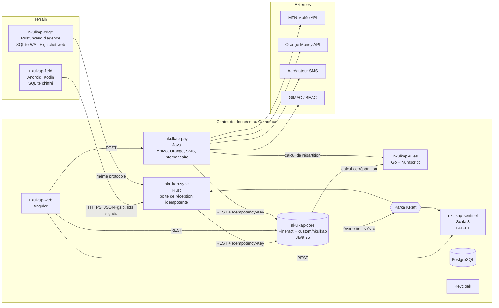
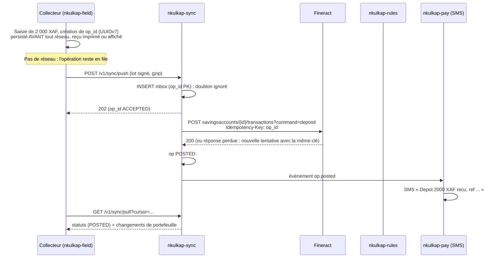

<!-- Généré par scripts/split-spec.sh depuis NKULKAP_cahier_des_charges_et_plan.md, lignes 175 à 243. Ne pas modifier à la main : modifier la référence puis relancer le script. -->

## 4. Architecture cible

Pour la lisibilité, le schéma omet deux familles de liens : tous les services centraux utilisent PostgreSQL (une base par service, plus les bases de locataires de Fineract), et toutes les authentifications passent par Keycloak.

### 4.1 Flux d'une collecte hors-ligne (cas central)

---

