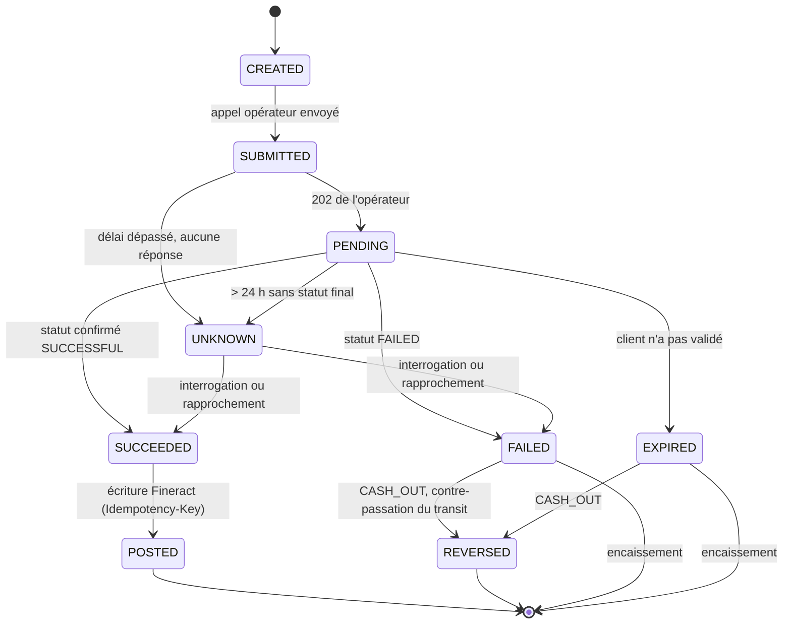
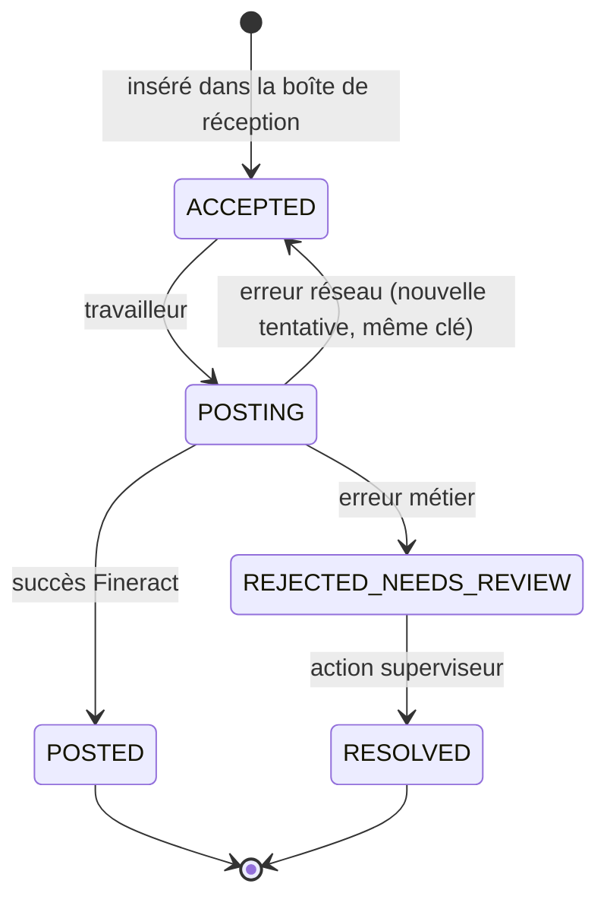
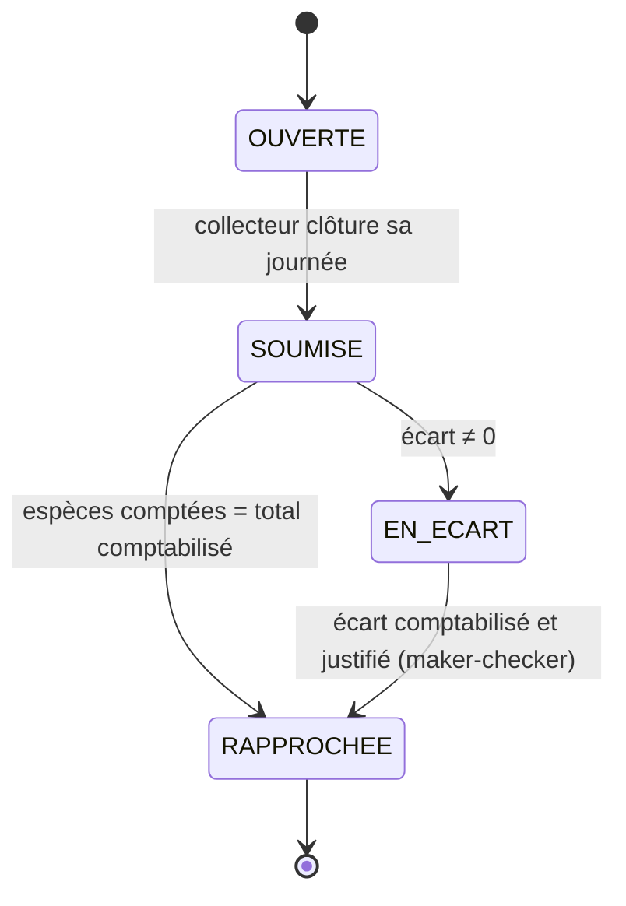

<!-- Généré par scripts/split-spec.sh depuis NKULKAP_cahier_des_charges_et_plan.md, lignes 1466 à 1518. Ne pas modifier à la main : modifier la référence puis relancer le script. -->

### Annexe D — Machines à états

#### D.1 Intention de paiement (`nkulkap-pay`)

#### D.2 Opération synchronisée (`nkulkap-sync`)

#### D.3 Tournée de collecte

> Une tournée ne peut passer en RAPPROCHÉE que lorsque toutes ses opérations sont POSTED ou RESOLVED.

